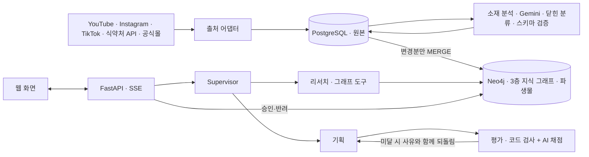

# beauty-ad-creative-agents

공개 플랫폼에서 수집한 뷰티 광고 메타데이터를 영상 분석으로 구조화해 Neo4j 지식 그래프에 넣고, 역할이 나뉜 에이전트(Supervisor·리서치·기획·평가)가 그 그래프를 근거로 **근거가 달린 광고 기획안**을 만드는 포트폴리오 프로젝트다. 브랜드 마케터가 경쟁사 광고 수십 개를 직접 보고 정리하는 일을 대신하는 것이 목표다.

사전 등록한 기준으로 구조의 효과를 쟀고, 결과는 기대와 달랐다. Supervisor 구조는 단일 에이전트보다 요청 적합도가 낮고 비용·지연이 컸다([E2](docs/results/2026-11-20-p6-final.md)). 그래프는 사전 등록 구성에서 벡터 검색보다 정답률이 높다는 기준을 넘지 못했다([E3](docs/results/2026-11-20-p6-final.md)). 다른 테넌트 데이터 노출은 200건 요청에서 0건이었다([격리](docs/results/2026-11-20-p6-final.md)). 아래 수치는 모두 관측값이며 일반화하지 않는다. 분모와 조건은 [평가·관측](#평가관측)에 적었다.

## 목차

- [아키텍처](#아키텍처)
- [실행 방법](#실행-방법)
- [평가·관측](#평가관측)
- [설계 트레이드오프](#설계-트레이드오프)
- [알려진 한계](#알려진-한계)
- [데이터 고지](#데이터-고지)
- [라이선스·A·B 저장소와의 관계](#라이선스ab-저장소와의-관계)

문서: [PRD](docs/PRD.md)(목표·범위), [ARCHITECTURE](docs/ARCHITECTURE.md)(구성), [ADR](docs/ADR.md)(결정), [EVAL](docs/EVAL.md)(평가 지표와 동결 기준), [결과 문서](docs/results/)(관측 근거), [CONTRACTS](docs/CONTRACTS.md)(외부 응답 실측), [TAXONOMY](docs/TAXONOMY.md)(닫힌 분류), [RUNBOOK](docs/RUNBOOK.md)(모든 실행 명령), [DEMO](DEMO.md)(시연 절차), [공개 전 체크리스트](docs/PUBLIC_RELEASE_CHECKLIST.md), [서드파티 고지](THIRD_PARTY_NOTICES.md).

## 아키텍처



- **데이터 흐름.** 수집은 판단이 없는 정해진 작업이라 에이전트가 아니라 파이프라인이다. 영상·캡션은 소재 분석 에이전트가 `docs/TAXONOMY.md`의 닫힌 분류로 라벨을 뽑고 스키마 검증을 통과한 것만 저장한다. **PostgreSQL이 원본이고 Neo4j는 거기서 만든 파생물**이며, 적재는 MERGE로 반복해도 결과가 같다. 영상·이미지 파일은 분석이 끝나면 지우고 추출한 사실과 원본 링크만 남긴다.
- **3층 지식 그래프.** 1층은 제품 지식(식약처 공공 API·브랜드 공식몰), 2층은 광고 관찰(소재 분석 라벨), 3층은 마케터의 승인·반려 피드백이다. 3층은 작업 공간(테넌트) 전용이다. 에이전트에게 Cypher를 쓰게 하지 않고 분류의 닫힌 값만 받는 고수준 도구를 준다.
- **Supervisor와 역할 분리.** Supervisor가 요청 유형을 가르고 과제 지시서를 만든다. 리서치는 그래프 도구로 근거를 모으고, 기획과 평가는 다른 공급사 모델을 쓴다. 평가가 기준에 못 미치면 사유와 함께 기획으로 되돌리며 횟수에는 상한이 있다. 효능 근거를 확인하지 못하면 기획을 진행하지 않거나 사용자에게 되묻는다.
- **코드 검사와 AI 평가의 분리.** 근거 ID 존재, 금지 표현, 분류 값 유효성처럼 판정할 수 있는 것은 `checks/`가 코드로 판정한다. LLM 채점은 차별성과 요청 적합성에만 쓴다.
- **검증된 집계와 모델 작성값의 구분.** 집계 수치는 도구 출력에 있는 값만 "검증됨"으로 보인다. 모델이 직접 쓴 수치는 "모델 작성값, 검증되지 않음"으로 따로 표시하고, 도구 출력에 없는 수치는 Supervisor가 제외한다. 실행 기록 화면에서 세 블록(검증됨·미검증·제외됨)을 구분해 볼 수 있다.
- **테넌트 격리와 비용 상한.** `tenant_id`는 세션에서만 나오고 도구 입력에는 테넌트 칸이 없다. 외부 호출은 래퍼 한 곳을 거치며 유료 모델 호출 직전에 공급사별 누적액을 검사해 상한을 넘으면 호출하지 않는다.

계층별 import 규칙은 [AGENTS.md](AGENTS.md#계층-경계)와 `tests/test_architecture.py`가 강제한다.

## 실행 방법

사전 요구는 Python 3.12(uv 관리)·uv, Node 24·pnpm, Docker다. 설정 변수 이름은 [`.env.example`](.env.example)에 있고 `.env`에 사용자가 값을 채운다. 설치와 live 실행, API 호출은 사용자가 직접 한다.

키·네트워크·실제 서비스 없이 검증한다(합성 데이터와 계약 응답 기록만 쓴다):

```bash
uv sync --locked
make web-install
make verify
```

`make verify`는 ruff, pytest, 웹 lint·typecheck·테스트를 실행한다.

시연 환경은 한 줄로 띄운다. **저장소에는 수집 원본이 없으므로** 이 명령은 PostgreSQL 원본과 Neo4j 데이터가 준비된 환경을 전제로 하고, 수집·분석·데이터 이관은 하지 않는다. 요청을 보내면 유료 모델이 호출된다(비용은 [DEMO.md](DEMO.md) 참고).

```bash
make db-up
make db-migrate   # 처음 한 번
make demo-up
# http://127.0.0.1:3000
```

수집·분석·그래프 동기화·평가 실행 등 나머지 명령과 설명은 [RUNBOOK](docs/RUNBOOK.md)에 있다.

## 평가·관측

아래는 `docs/results/`에 적힌 값을 옮긴 것이며 새로 계산하지 않았다. 판정 이름(`single_better`·`not_adopted`·`not_met`)은 사전 등록 기준에 대한 측정 판정일 뿐 설계 판단에 쓰이지 않는다. 사전 등록 문서와 동결 기준은 [EVAL.md](docs/EVAL.md)와 [P6 사전 등록](docs/results/p6_preregistration.md)에 있다.

| 항목 | 관측값 | 출처 |
|---|---|---|
| E2 Supervisor 대 단일 에이전트 (요청 20건 × 반복 2회) | 판정 `single_better`. 평균 차이(Supervisor − 단일): 요청 적합도 −0.475 [−0.8, −0.15], 차별성 +0.05 [−0.05, 0.175], 근거 유효율 −0.075 [−0.15, 0.0]. 요청당 비용 $0.0265 대 $0.0121, 지연 33.7초 대 17.2초, 모델 호출 8.3 대 3.8 | [P6 최종 결과 2.1](docs/results/2026-11-20-p6-final.md) |
| E3 그래프 대 벡터 (질문 37건) | 판정 `not_adopted`. 전체 정답률 그래프 5.4% 대 벡터 10.8%, 관계 질문(27건) 7.4% 대 0%, 단순 검색(10건) 0% 대 40%. 근거 적중률은 그래프 1.0 대 벡터 0.0 | [P6 최종 결과 2.3](docs/results/2026-11-20-p6-final.md) |
| E5 켬 대 끔(토큰·근거) | 판정 `not_met:both`. 토큰 감소 6.98%(기준 30%), 근거 유효율 차이 −0.075 [−0.15, 0.0] | [P6 최종 결과 2.2](docs/results/2026-11-20-p6-final.md) |
| 테넌트 격리 (200건 요청) | 다른 테넌트 데이터 노출 0, 정상 응답 100%, 다른 테넌트 스레드 접근 25/25 거부(403), 비용 $0.518. 0건은 관측값이지 증명이 아니다 | [P6 최종 결과 2.4](docs/results/2026-11-20-p6-final.md) |
| E1 라벨 신뢰도 (사람·모델 κ, 기준 0.6) | `category` 0.8669(n=47, 충족), `hook_type` 0.4070·`angle` 0.4260(미충족). 14개 축 중 7개 충족, 7개 미충족. 콘텐츠 유형 재현율 0.9592(기준 0.9) | [E1 채점 결과 2](docs/results/2026-11-19-e1-scoring.md) |

결과를 본 뒤의 분석은 "사후 진단"으로 따로 표시했다. 예를 들어 E2의 격차는 효능이 test 브랜드 제품과 맞지 않는 요청에 몰렸고, E3는 도구가 결과를 5행으로 제한하는 비교 구성의 한계가 있어 그래프가 열세라는 뜻이 아니라는 해석이 결과 문서에 있다. 해석과 한계는 각 출처를 따른다. E1의 미충족 축은 "라벨 신뢰도 낮음"으로 표시하고 결론의 근거로 쓰지 않으며, 사람 재검사 κ는 기억 효과를 포함한 값이라 재현성의 근거로 쓰지 않는다.

에이전트별 지연과 비용을 Langfuse에서 관측했다. (확인 기록: DEMO.md "Langfuse 확인 기록")

이 문장의 수치(시연 요청 1건 약 31.65초, 합계 $0.0618)는 사용자 화면 관측값이며 `docs/results/`의 측정값이 아니다.

## 설계 트레이드오프

수치와 사실은 링크한 결과 문서·ADR의 표현을 따른다.

1. **Supervisor 구조를 유지한다.** 사전 등록 측정에서 `single_better`가 나왔지만 Supervisor 구조는 설계 전제로 유지한다(용도: 브랜드 마케터가 경쟁사 광고 패턴을 참고해 기획하는 일, [결과 0절](docs/results/2026-11-20-p6-final.md)). 대안은 단일 에이전트였다. 대가는 요청당 비용 $0.0265 대 $0.0121, 지연 33.7초 대 17.2초다.
2. **온톨로지 그래프를 설계 전제로 둔다.** E3가 `not_adopted`여도 그래프를 유지한다([ADR](docs/ADR.md)의 ADR-006). 대안은 벡터 검색만 쓰는 것이었다. 대가는 그래프 도구가 다루지 못하는 질문이다(CQ-11은 조회 도구가 없어 그래프 0/9, 벡터 4/9, [결과 3.2](docs/results/2026-11-20-p6-final.md)).
3. **PostgreSQL을 원본으로, Neo4j를 파생물로 둔다.** 그래프를 언제든 원본에서 다시 만들 수 있고 "바뀐 행"은 PostgreSQL의 변경 시각으로 판정한다. 대가는 두 저장소를 동기화해야 하는 운영 부담이다.
4. **효능 근거가 없으면 기획하지 않는다.** 근거 없이 쓴 기획안은 신뢰할 수 없다는 결정으로, 조회 실패·제품 미등록·확인된 효능 0개에서는 기획을 진행하지 않거나 되묻는다([결과 5절](docs/results/2026-11-20-p6-final.md)). 대안은 요청 효능을 그대로 쓰는 것이었다. 대가는 요청 적합도 하락이다(결과 3.1은 효능이 제품과 맞지 않는 요청에서 격차가 컸다고 기록한다).
5. **영상 파일을 저장하지 않는다.** 분석이 끝나면 지우고 추출한 사실과 원본 링크만 남긴다. 대가는 같은 영상을 다시 분석하려면 다시 받아야 한다는 점이다.

## 알려진 한계

이 프로젝트가 **입증하지 않는 것**을 먼저 적는다.

- Supervisor 구조가 단일 에이전트보다 낫다는 것(측정에서는 반대 방향이었다).
- 그래프가 벡터 검색보다 검색 정답률이 높다는 것(사전 등록 구성에서 기준을 넘지 못했다).
- 어느 방식이 더 안전하다는 것. 안전성 차이는 측정되지 않았다.
- 생성한 기획안이 실제 광고 성과를 높인다는 것. 광고 성과는 측정하지 않았다.
- 라벨의 재현성과 라벨러 간 일치. 라벨러는 1명이고 재검사는 기억 효과를 포함한다.

그 밖의 한계:

- 표본이 작다. 요청 20건, E3 질문 37건, E1 라벨 48건(지원 3개 카테고리)이다.
- 도구 관측 창이 5행이라 E3 비교가 그래프에 불리하게 제한됐다([결과 3.2](docs/results/2026-11-20-p6-final.md)).
- 사람의 claim 일치 판정은 수행하지 않았다.
- 대화 압축·재작업 경로는 검증하지 않았다.
- 최종 실험 뒤에 기획 프롬프트와 되묻기 흐름이 바뀌어 사전 등록 동결 줄과 현재 코드가 다르다. 실험은 끝났고 재실행하지 않았다.
- 성과 지표(조회수·좋아요)는 광고비로 올린 조회와 자연 조회를 구분하지 못한다. Instagram 릴스는 표본 195건 중 101건만 영상 주소가 반환되어 나머지는 캡션·지표만 분석했다([PRD](docs/PRD.md)).
- 이미지 생성 모델이 만든 시안은 실제 광고가 아니다. 결과 문서에는 이미지 안 글자·라벨이 찌그러져 카피 글자를 코드가 폰트로 합성하도록 바꾼 기록이 있다([P5 결과 8·9.6절](docs/results/2026-11-18-p5-live-agents.md)).
- DEMO.md의 사용자 live 리허설 확인 결과 칸은 비어 있다. 시연 영상은 아직 없다.

## 데이터 고지

공개 플랫폼에서 수집한 뷰티 광고 메타데이터를 분석한다. 저장소에는 수집 원본·중간 산출물·생성 시안 이미지를 포함하지 않는다(`data/raw`, `data/interim`, `data/design` 제외). `tests/fixtures/contracts`에는 계약 확인용 API 응답 기록이 있고 공개 게시물 원문 일부가 포함되며 권리는 원 소유자에게 있다. 시안 이미지는 AI가 생성한 것이며 실제 광고가 아니다. 연구·포트폴리오 용도이다.

## 라이선스·A·B 저장소와의 관계

[MIT License](LICENSE)를 사용한다. 저작권자는 Tommy Lee다. 서드파티 자료(Pretendard 폰트 등)는 [THIRD_PARTY_NOTICES.md](THIRD_PARTY_NOTICES.md)에 적었다. 위 데이터 고지의 수집 데이터는 이 라이선스의 대상이 아니다.

같은 작성자의 포트폴리오 프로젝트로 [A: ko-docs-agentic-rag](https://github.com/apinkpanda722/ko-docs-agentic-rag)(한국어 사내 문서 Agentic RAG와 평가 하네스)와 [B: governed-ops-agent](https://github.com/apinkpanda722/governed-ops-agent)(운영 에이전트와 거버넌스 게이트웨이)가 있다. 이 저장소(C)는 A·B의 코드나 데이터를 참조하지 않으며 독립적으로 실행된다.
