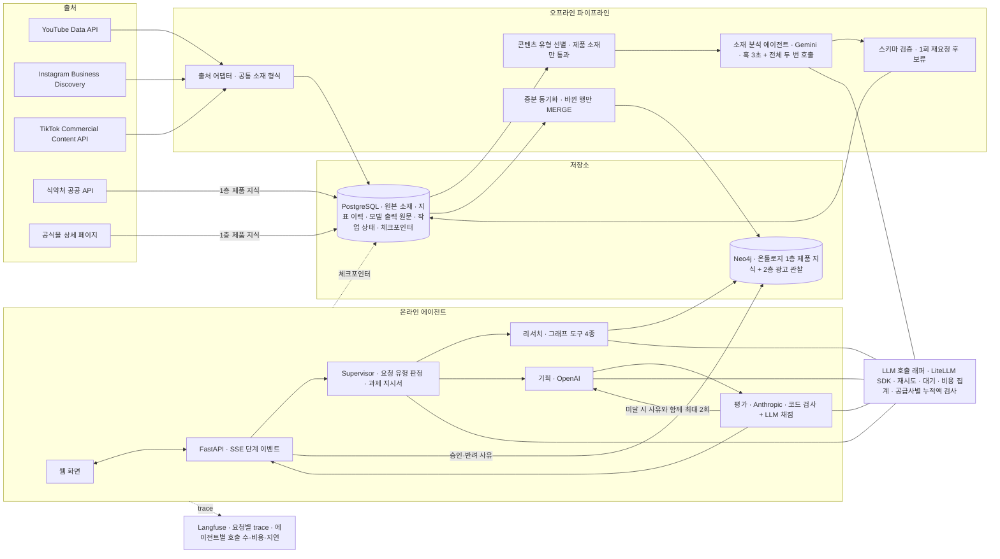
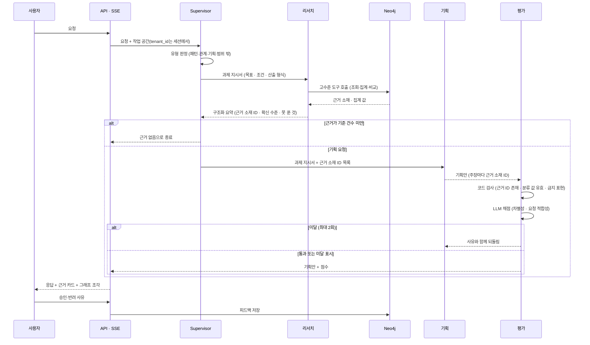
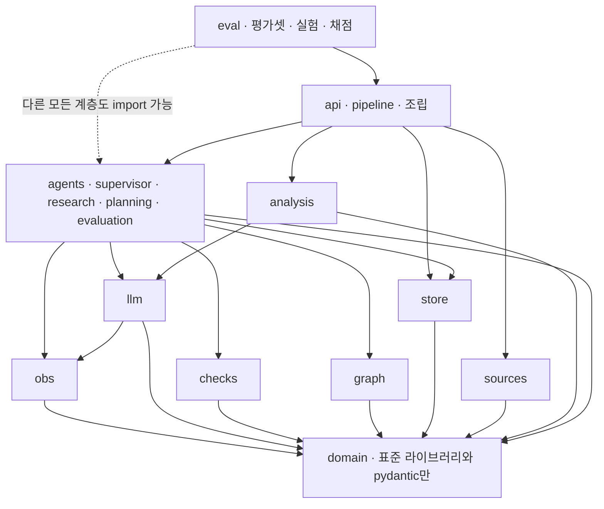

# beauty-ad-creative-agents

뷰티 광고 크리에이티브를 분석해 근거가 달린 기획안을 만드는 멀티에이전트 프로젝트.

## live-graph (P4)

PostgreSQL 원본에서 Creative와 분류 축(Hook·Angle·Format·Talent·CtaType)을
Neo4j로 증분 동기화한다. OrbStack을 켜고 `.env`에 `POSTGRES_PASSWORD`와
`NEO4J_PASSWORD`(8자 이상)를 준비한 뒤 사용자가 다음 명령을 실행한다.
수집·분석 결과가 PostgreSQL에 있어야 하며 모델 호출과 다운로드는 없다.

```bash
make db-up
# 컨테이너가 준비된 뒤 사용자가 실행한다.
make live-graph
# 전체 변경분 동기화와 선택적 읽기 상한·재구축
make sync
make sync ARGS='--limit 50'
make sync ARGS='--full'
```

Neo4j 주소 기본값은 `bolt://127.0.0.1:7688`이며 필요하면
`BEAUTYADS_NEO4J_URI`로 바꾼다. PostgreSQL 호스트 포트는 기본 5433이고
기존 `BEAUTYADS_POSTGRES_PORT`를 따른다. Neo4j 드라이버는 `6.4.1`이다.

`make live-graph`는 `--limit 50 --verify`로 읽은 동일 소재 묶음을 두 번
적재한다(변경분이 적으면 50건 미만). 두 번째 `nodes_created`와
`relationships_created`가 0인지, 두 번의 Creative `count`가 같은지,
분류 값 노드가 닫힌 목록 안인지 `count`로 확인하고 요약의 `verification`에
출력한다. 기본 동기화 요약에는 `read`, `nodes_created`,
`relationships_created`, `skipped_invalid`, `watermark`, `elapsed_s`가 나온다.
변경분이 없으면 정상 0건 요약이며 워터마크는 유지된다.

변경 판정은 소재와 최종 분석 작업의 PostgreSQL `updated_at`으로 한다.
워터마크보다 10분 앞에서 겹쳐 읽고, 모든 적재와 선택적 검증이 성공한 뒤에만
읽은 행의 최대 변경 시각으로 워터마크를 올린다. `--full`은 워터마크를
무시하고 처음부터 MERGE하며 그래프를 삭제하지 않는다. `properties_set`은
같은 값을 다시 써도 증가하므로 변경 판정에 쓰지 않는다.
라벨은 `FINAL_RUN_TAG`의 `content_type@v1`·`hook@v1`·`full@v1` 중
`done` 작업만 사용한다. 제품 소재에만 분류 축 관계를 만들고 목록 밖 값은
`skipped_invalid`로 센다. 기존 v1 훅 라벨은 묘사 필드가 없으므로,
훅 묘사는 원본 라벨에 `hook_description`이 있을 때만 관계에 기록한다.

**첫 볼륨 비밀번호 함정:** Neo4j 비밀번호는 데이터 볼륨을 처음 만들 때만
적용된다. 나중에 `.env`만 바꾸면 인증에 실패한다. 원래 비밀번호를 확인하고,
그래프를 원본에서 다시 만들기로 결정한 경우에만 사용자가 기존
`make graph-reset CONFIRM=yes`와 `make db-up`, `make sync ARGS='--full'`을
차례로 실행한다. `graph-reset`은 그래프 데이터를 삭제한다.
PostgreSQL도 비밀번호가 첫 볼륨에 적용되므로 기존 원본 볼륨의 비밀번호를
확인한다.

실패 출력은 `PREFLIGHT_FAILED <코드>`와 종료 코드 2, 정상 완료는 0이다.
점검이 실패하면 드라이버 생성과 저장소 접속을 하지 않는다. 키·비밀번호·URI의
인증 정보는 출력하지 않으며 두 Make 타깃은 `verify`에 포함하지 않는다.

| 이유 코드 | 의미와 조치 |
|---|---|
| `ENV_MISSING:NEO4J_PASSWORD` | 공백이 아닌 Neo4j 비밀번호를 설정한다. |
| `ENV_MISSING:POSTGRES_PASSWORD` | 공백이 아닌 PostgreSQL 비밀번호를 설정한다. |
| `INVALID_SETTING:NEO4J_PASSWORD` | Neo4j 비밀번호를 8자 이상으로 설정한다. |
| `DOCKER_DOWN` | OrbStack을 켜고 Docker 데몬 준비를 기다린다. |
| `POSTGRES_UNREACHABLE` | `make db-up`과 PostgreSQL 노출 포트를 확인한다. |
| `NEO4J_UNREACHABLE` | `make db-up`과 Neo4j 주소·노출 포트를 확인한다. |
| `NEO4J_AUTH_VOLUME_STALE` | 비밀번호는 데이터 볼륨을 처음 만들 때만 적용된다. 원래 값을 확인하거나 명시적으로 `make graph-reset`으로 재구축한다. |
| `NEO4J_CONSTRAINT_VIOLATION` | 원본 키와 기존 그래프의 유일 제약 위반 데이터를 확인한다. |
| `POSTGRES_AUTH_FAILED` / `POSTGRES_CONNECT_FAILED` | 원본 DB의 비밀번호·컨테이너·포트를 확인한다. |
| `GRAPH_VERIFY_FAILED` | 반복 적재의 생성 수·Creative 수·닫힌 목록 검증이 실패했다. 워터마크를 갱신하지 않는다. |
| `SYNC_FAILED` | 원본 스키마·데이터 형식·실행 환경을 확인하고 다시 실행한다. 워터마크 이전에 실패했다면 겹쳐 읽어 재적재한다. |

- 하네스 사용법: [scripts/README.md](scripts/README.md)
- 요구사항·설계·결정 기록: [docs/](docs/)

## 구성도

아래 그림은 `docs/ARCHITECTURE.md`의 글과 `AGENTS.md` 계층 경계 표, `tests/test_architecture.py`의 `LAYER_IMPORTS`에 적힌 구성만 옮긴 것이다. 구현이 바뀌면 같이 고친다.

### 1. 전체 구성



### 2. 요청 한 번의 흐름 (온라인)



### 3. 계층 의존 방향 (코드 구조)



화살표는 "import할 수 있다"는 방향이다. 출처는 `AGENTS.md`의 계층 경계 표와 `tests/test_architecture.py`의 `LAYER_IMPORTS`이며 정확한 허용표는 테스트가 기준이다. `api`와 `pipeline`은 `domain`부터 `agents`까지 모든 계층을 직접 import할 수 있고(그림은 중복을 줄여 일부 화살표를 생략했다), 서로를 import하지 않는다. `eval`은 `api`·`pipeline`을 포함한 다른 모든 계층을 import할 수 있고 다른 계층은 `eval`을 import하지 않는다. `settings`(루트 모듈, `.env`를 읽는 유일한 함수)는 `obs`·`llm`·`sources`·`store`·`graph`·`api`·`pipeline`·`eval`이 import할 수 있어(`LAYER_IMPORTS` 기준) 그림에서 뺐다. 외부 SDK는 `litellm`은 `llm`, `neo4j`는 `graph`, `httpx`는 `sources`, `langfuse`는 `obs`, `fastapi`는 `api`, `psycopg`는 `store`와 `api`, `langgraph`는 `agents`와 `api`에서만 쓴다.

## E1 라벨링 시트 (P3)

두 명령은 사용자가 직접 실행한다. `config/e1_sampling.yaml`과 사전 등록
`docs/results/e1_preregistration.md`의 sha256을 각 단계의 키 파일과 시트 안내문
메타데이터에 기록한다. 설정을 바꾸면 기존 1단계 키로 2단계를 만들 수 없다.
모델 분석 결과·지표·게시 시각은 선정에 쓰지 않는다.

```bash
# 수집과 test 분할 확정, content_type·category 부분 동결 뒤 실행한다.
# PostgreSQL만 사용한다. POSTGRES_PASSWORD 설정과 Docker·DB 준비가 필요하다.
make e1-stage1
# 기본 폴더를 바꾸려면 data/interim 아래를 지정한다.
uv run python -m beautyads.eval.e1_sampling --out-dir data/interim/e1
```

기본 폴더 `data/interim/e1`에 `e1_stage1_sheet.csv`,
`e1_stage1_codebook.csv`, `e1_stage1_instructions.md`, `e1_stage1_key.json`을
만든다. test 브랜드의 명시적으로 분석 가능한 YouTube·Instagram 소재에서
출처×브랜드 층을 번갈아 뽑는다. 중복 키는 YouTube의
`(source, account, title, caption)`, Instagram의 `(source, account, caption)`이다.
문자열 완전 일치로 묶어 그룹당 시드 무작위 대표 1건을 남기며,
키 필드가 하나라도 비었거나 공백뿐이면 각각 남긴다. DB 행은 변경하지 않는다.
요약에는 출처·브랜드별 프레임 건수, 중복 제거 전후·출처별 제외 건수,
`shortfall`(전체 부족분과 균등 할당 대비 층별 부족분), 산출물 경로가 나온다.
다른 층에서 보충되면 전체 부족분은 0이어도 층별 부족분이 있을 수 있다.

시트를 위에서부터 **건너뛰지 않고** `content_type`·`category`를 함께 라벨링한다.
사람이 `product_creative`로 판정한 건이 50건 이상이면서 100건 이상 라벨링한
첫 행에서 멈춘다. 최대 200건이며, 뒤의 빈 행은 그대로 둬도 된다.
사람 라벨은 `data/interim/e1/e1_stage1_sheet_labeled.csv`에 저장한다.
**키 파일은 라벨링 뒤에만 연다.** CSV에는 영상 주소·제목·캡션과 라벨 칸만
있고, Instagram은 만료되는 media_url 대신 permalink를 쓴다.

```bash
# 나머지 축의 전체 v1 동결 뒤, 1단계 라벨을 저장한 다음 직접 실행한다.
make e1-stage2
uv run python -m beautyads.eval.e1_stage2 \
  --labels data/interim/e1/e1_stage1_sheet_labeled.csv \
  --key data/interim/e1/e1_stage1_key.json --out-dir data/interim/e1
```

2단계는 DB·네트워크에 접속하지 않는다. 두 정지 조건을 처음 만족한 행까지만
사용하고 이후 라벨 건수는 `unused_count`로 보고한다. 그 범위의 사람 제품
라벨을 출처×사람 카테고리로 층화해 50건을 뽑는다. 제품이 부족해도 가능한
건수로 계속하며 종료 코드는 0이다. `e1_stage2_sheet.csv`,
`e1_stage2_codebook.csv`, `e1_stage2_instructions.md`, `e1_stage2_key.json`을
만든다. 2단계 키에만 1단계 사람 라벨과 1단계 키 sha256을 남긴다.
2단계 시트에는 content_type·category·ingredients가 없으며 `claims`는 쉼표로
구분해 여럿 선택한다.

첫 라벨을 `e1_stage2_sheet_labeled.csv`에 저장하고, **7일 뒤** 원래의 빈
`e1_stage2_sheet.csv`를 복사해 같은 항목·순서를 다시 라벨링한다.
첫 라벨과 키를 가린 채 `e1_stage2_sheet_retest.csv`에 저장한다.
기존 산출물은 어느 단계도 덮어쓰지 않는다. 재생성이 필요하면 기존 라벨을
보존할지 검토한 뒤 사용자가 해당 단계의 네 산출물을 직접 치워야 한다.
두 Make 타깃은 `verify`에 포함하지 않는다.

| 이유 코드 | 의미와 조치 |
|---|---|
| `PREREGISTRATION_MISSING` | 사전 등록 파일이 없거나 읽을 수 없다. 등록된 파일을 준비한다. |
| `E1_CONFIG_INVALID` | 설정 파일 누락·키 누락·알 수 없는 키·형식·범위 오류다. 등록한 설정을 확인한다. |
| `E1_SPLIT_FILE_INVALID` | 1단계의 브랜드 분할 파일 존재·형식을 확인한다. |
| `ENV_MISSING:POSTGRES_PASSWORD` | 1단계 실행에 필요한 공백이 아닌 설정을 준비한다. |
| `DOCKER_DOWN` / `POSTGRES_UNREACHABLE` | Docker·DB와 노출 포트(기본 5433, `BEAUTYADS_POSTGRES_PORT`)를 확인한다. |
| `POSTGRES_AUTH_FAILED` / `POSTGRES_CONNECT_FAILED` | 비밀번호·DB 준비 상태를 확인한다. |
| `E1_FRAME_EMPTY` | test 브랜드에 해당하는 분석 가능한 두 출처 소재가 없다. |
| `OUTPUT_NOT_IGNORED` | 출력은 `data/interim` 아래만 허용한다. 경로·심볼릭 링크 이탈을 확인한다. |
| `E1_OUTPUT_EXISTS` | 해당 단계 산출물이 이미 있다. 기존 파일을 덮어쓰지 않고 중단한다. |
| `E1_OUTPUT_WRITE_FAILED` | 출력 폴더의 쓰기 권한·여유 공간을 확인한다. |
| `LABEL_FILE_MISSING` | 1단계 사람 라벨 파일이 없다. `--labels` 경로를 확인한다. |
| `LABEL_FILE_INVALID` | 열·코드북 값·항목 번호·연속 라벨링 순서·키 형식 또는 등록·설정 해시가 잘못됐다. |
| `E1_PRODUCT_SHORTFALL <k>` | 정지 범위의 제품 소재가 목표보다 k건 부족하다. 가능한 제품으로 계속한다. |

오류는 `PREFLIGHT_FAILED <코드>`와 종료 코드 2다. 정상 생성과 제품 부족은 0이다.

## live-slice (P1)

YouTube 소재 수집 → 첫 3초 훅 분석 → PostgreSQL 저장을 확인한다.
OrbStack을 켜고 `.env`에 `YOUTUBE_API_KEY`, `GEMINI_API_KEY`,
`POSTGRES_PASSWORD`를 설정한다. `make db-up`은 Neo4j도 올리므로
`NEO4J_PASSWORD`(8자 이상)도 필요하다. 이 CLI는 Neo4j를 사용하지 않는다.

```bash
make db-up
# 컨테이너 준비까지 수 초 기다린 뒤 실행한다.
make live-slice
```

기본 수집 상한은 1건이다. 아래 모듈 명령에 `--count`로 1~5건을 지정할 수 있다.
환경 점검만 하려면 다음을 실행한다(모델 호출·DB 접속 없음).

```bash
uv run python -m beautyads.pipeline.slice --preflight-only
```

정상 출력은 소재별 JSON 한 줄과 마지막 요약 한 줄이다. 아래는 값 없이 필드
이름만 표시한 출력 형식이다.

```text
event, source, source_id, url, status, hook_type, error_code
event, collected, analyzed, stopped, gemini_total_usd
```

`analyzed`는 분석 상태별 건수이며, 중단 시 남은 작업은 `pending`으로 보존한다.
분석 1건 비용은 약 $0.006 추정이며 실제 비용은 `data/manifest/costs.jsonl`에
기록한다. 기본 Gemini 누적 상한은 $12다. 키·DSN·API 요청 쿼리와 영상 파일
경로는 출력하지 않으며 영상 파일은 다운로드하지 않는다.

점검 실패는 `PREFLIGHT_FAILED <코드>`와 종료 코드 2, 한도 등 실행 중단은
`STOPPED <사유>`와 종료 코드 3, 정상 완료·점검 통과는 종료 코드 0이다.

| 이유 코드 | 조치 |
|---|---|
| `ENV_MISSING:YOUTUBE_API_KEY` | `.env`에 해당 이름의 공백이 아닌 값을 설정한다. |
| `ENV_MISSING:GEMINI_API_KEY` | `.env`에 해당 이름의 공백이 아닌 값을 설정한다. |
| `ENV_MISSING:POSTGRES_PASSWORD` | `.env`에 해당 이름의 공백이 아닌 값을 설정한다. |
| `DOCKER_DOWN` | OrbStack을 켜고 Docker 데몬이 준비될 때까지 기다린다. |
| `POSTGRES_UNREACHABLE` | `make db-up` 뒤 잠시 기다렸다가 다시 시도한다. 기본 포트는 5433이며 `BEAUTYADS_POSTGRES_PORT`를 쓰면 실제 노출 포트와 맞춘다. |
| `COST_CAP:gemini` | 원장 누적액과 비용 상한 설정을 확인한 뒤 예산을 결정한다. |
| `LEDGER_NOT_WRITABLE` | 원장 경로와 부모 디렉터리의 쓰기 권한·여유 공간을 확인한다. |
| `POSTGRES_AUTH_FAILED` | PostgreSQL 비밀번호는 데이터 볼륨을 처음 만들 때만 적용된다. P1은 데이터가 없으니 `.env`의 `POSTGRES_PASSWORD`를 원래 값으로 되돌리거나 볼륨을 직접 삭제한다(삭제 타깃은 만들지 않았다). |
| `POSTGRES_CONNECT_FAILED` | PostgreSQL 비밀번호는 데이터 볼륨을 처음 만들 때만 적용된다. P1은 데이터가 없으니 `.env`의 `POSTGRES_PASSWORD`를 원래 값으로 되돌리거나 볼륨을 직접 삭제한다(삭제 타깃은 만들지 않았다). 컨테이너 상태와 포트도 확인한다. |
| `DAILY_LIMIT` / `RATE_LIMITED` | 한도가 회복된 뒤 다시 실행한다. 대기 작업은 보존된다. |
| `YOUTUBE_KEY_INVALID` / `YOUTUBE_QUOTA` | YouTube 키 설정 또는 할당량을 확인한 뒤 다시 실행한다. |

## live-collect (P2)

YouTube·Instagram의 메타데이터만 수집해 PostgreSQL에 저장한다. 영상 파일을
다운로드하거나 모델을 호출하지 않으므로 모델 비용은 없다. OrbStack을 켜고
`.env`에 `YOUTUBE_API_KEY`, `INSTAGRAM_ACCESS_TOKEN`, `INSTAGRAM_USER_ID`,
`POSTGRES_PASSWORD`를 설정한다. **`INSTAGRAM_USER_ID`는 호출 주체인 내 Instagram
사용자 ID이며, 사용자가 `.env`에 값을 추가해야 한다.** `make db-up`에는
`NEO4J_PASSWORD`(8자 이상)도 필요하다. 수집기는 Neo4j를 사용하지 않는다.
Instagram 기본 URL은 `https://graph.facebook.com/v21.0`이며 필요할 때만
`BEAUTYADS_INSTAGRAM_BASE_URL`로 바꾼다.

먼저 `--dry-run`으로 호출 수·예상 소요 시간을 확인한다. 이 모드는 키 없이
실행할 수 있으며 HTTP·DB 접속과 Docker 점검을 하지 않는다.

```bash
uv run python -m beautyads.pipeline.collect --dry-run
make db-up
# 컨테이너가 준비된 뒤 사용자가 실행한다(권장: 11-15~16).
make live-collect
```

기본값은 두 출처 모두, 계정당 최대 150건이다. `--max-per-account` 범위는
1~1000이며 YouTube는 영상 수, Instagram은 게시물 수다. 호출 수 추정은
YouTube 채널당 `1 + 2 × ceil(N / 50)`, Instagram 계정당 `ceil(N / 100)`이다.
호출당 시간은 가정(미실측)이며 YouTube 쿼터 사용량은 미확인(Cloud 콘솔에서
확인)이다. Instagram은 호출당 앱 사용량 0.5%를 적용하지만 첫 live에서 과소추정으로 드러났다(13계정·약 26호출에 80% 도달, 어느 지표가 올랐는지는 미확인).
예를 들어 22계정 × 2쪽은 44호출이고 0.5% 가정으로는 약 22%지만 실제로는 그보다 훨씬 빨리 찼다.
사용량 창은 롤링이라 멈춘 뒤 약 1시간 기다렸다가 `--skip-recent-hours`로 이어 받는다.
오류·중단으로 끝난 계정은 저장하지 않으므로 이어 받을 때 다시 수집된다. 수집기는 수집기는 사용량 80% 이상이면 Instagram을 멈춘다.

```bash
uv run python -m beautyads.pipeline.collect --sources youtube --max-per-account 100
# 최근 24시간 안에 수집된 계정을 건너뛴다(기본 0은 끄기).
uv run python -m beautyads.pipeline.collect --skip-recent-hours 24
# 실패한 YouTube handle 또는 Instagram username만 다시 수집한다.
uv run python -m beautyads.pipeline.collect --accounts @torriden,torriden_official
```

계정 하나가 끝날 때마다 업서트하므로 중간에 끊겨도 앞 계정의 결과는 남고,
다시 실행해도 같은 소재가 중복되지 않는다. 계정별 오류는 다음 계정으로
넘어가고, 인증·한도 중단은 해당 출처만 멈춘다. 일시적인 읽기 요청 실패와
HTTP 500·502·503·504는 최대 3회 시도하며 400대는 재시도하지 않는다.

진행 중에는 계정별 JSON 한 줄(`event=account`)에 `source`, `brand`, `account`,
`fetched`, `analyzable_true`, `analyzable_false`, `analyzable_null`, `error`,
`skipped`를 출력한다. 마지막 `event=summary`의 `by_source_brand`는 저장소 전체의
출처·브랜드별 분석 가능 분포이며, `split_analyzable_true`는
`config/brand_split.yaml`에 따른 dev·test 합계다. 분할에 없는 브랜드와 브랜드가
없는 소재는 `unassigned`에 따로 센다. `stopped`는 출처별 중단 이유,
`elapsed_s`는 총 소요 초다. 키·토큰·요청 URL 쿼리·임시 영상 주소는 출력하지 않는다.

| 이유 코드 | 의미와 조치 |
|---|---|
| `ENV_MISSING:YOUTUBE_API_KEY` | YouTube를 선택했다면 해당 키를 설정한다. |
| `ENV_MISSING:INSTAGRAM_ACCESS_TOKEN` / `ENV_MISSING:INSTAGRAM_USER_ID` | Instagram을 선택했다면 토큰과 호출 주체 ID를 설정한다. |
| `ENV_MISSING:POSTGRES_PASSWORD` | PostgreSQL 비밀번호를 설정한다. |
| `DOCKER_DOWN` / `POSTGRES_UNREACHABLE` | OrbStack과 `make db-up`, 노출 포트(기본 5433)를 확인한다. |
| `POSTGRES_AUTH_FAILED` / `POSTGRES_CONNECT_FAILED` | 비밀번호·컨테이너·포트를 확인한다. 비밀번호는 볼륨 최초 생성 시 적용되므로 기존 볼륨이면 원래 값을 확인한다. |
| `YOUTUBE_KEY_INVALID` / `YOUTUBE_QUOTA` | YouTube만 중단한다. 키나 Cloud 콘솔 할당량을 확인한 뒤 재개한다. |
| `INSTAGRAM_TOKEN_INVALID` | Instagram만 중단한다. 토큰을 갱신한 뒤 재개한다. |
| `INSTAGRAM_USAGE_HIGH` / `INSTAGRAM_RATE_LIMITED` | Instagram만 중단한다. 사용량 창이 회복된 뒤 재개한다. |
| `CHANNEL_NOT_FOUND` / `CHANNEL_MISMATCH` / `INSTAGRAM_ACCOUNT_NOT_FOUND` | 해당 계정 설정을 확인한다. 다른 계정은 계속 수집한다. |
| `YOUTUBE_HTTP_*` / `YOUTUBE_REQUEST_FAILED` / `INSTAGRAM_ERROR_*` / `INSTAGRAM_REQUEST_FAILED` / `*_INVALID_RESPONSE` | 해당 계정의 요청·응답 오류다. 나머지 계정 수집 후 재실행한다. |
| `COLLECTION_ACCOUNT_FAILED` | 해당 계정의 수집 또는 저장이 실패했다. 저장소 상태와 계정 설정을 확인해 재실행한다. |
| `SPLIT_VOLUME_INSUFFICIENT` | 전체 저장소 기준 `volume_violations`를 확인한다. 자동 재분할은 하지 않는다. |

점검 실패는 `PREFLIGHT_FAILED <코드>`와 종료 코드 2, 출처 중단이 있으면
종료 코드 3, 그 밖에는 0이다. 수집량 미달만 있으면 종료 코드는 0이다.

**live 순서: `make live-collect` → 수집량 확인(`SPLIT_VOLUME_INSUFFICIENT` 유무)
→ 필요하면 라벨링 전에 1회 재분할 → 그 뒤에 `make live-pilot`.**
수집량이 모자라면 추가 수집을 검토하고, 라벨링 시작 전에 한해 이유를 적어
다음 명령으로 1회 재분할할 수 있다.

```bash
uv run python -m beautyads.sources.split --resplit --reason "수집량 확인 후 재분할 사유" --path config/brand_split.yaml
```

분할이 바뀌면 시범 20건도 바뀌므로 `make live-pilot`은 분할 확정 뒤에 실행한다
(P2 step 13에서 제공).

## live-pilot (P2)

**live 순서: `make live-collect` → 수집량 확인 → 필요 시 라벨링 전에 1회
재분할 → 그 뒤에 `make live-pilot`.** 수집을 완료하고
`config/brand_split.yaml`의 dev·test 수집량 기준을 충족해야 한다.
시범 실행기는 저장소의 `collection_stats()`로 이를 다시 검사하며 우회 옵션은 없다.
분할이 바뀌면 시범 20건도 바뀌므로 분할을 확정한 뒤 시작한다.

OrbStack을 켜고 `.env`에 `GEMINI_API_KEY`, `POSTGRES_PASSWORD`,
`INSTAGRAM_ACCESS_TOKEN`, `INSTAGRAM_USER_ID`를 설정한다. 시작 점검에서는
대상 출처를 아직 모르므로 Instagram 두 설정도 확인한다. `make db-up`에는
`NEO4J_PASSWORD`(8자 이상)도 필요하다. 시범은 PostgreSQL만 사용한다.

먼저 `--dry-run`으로 계획 호출 수와 영상 입력 토큰 추정을 확인한다.
이 모드는 키 없이 실행하며 Docker 점검·네트워크 호출·DB 접속·모델 호출을 하지 않는다.
금액은 추정하지 않는다. 비용은 원장에 기록되며 시범 뒤 `cost-recalc`가 계산한다.

```bash
uv run python -m beautyads.eval.pilot_run --dry-run
make db-up
# 컨테이너가 준비되고 수집량·분할을 확인한 뒤 사용자가 실행한다.
make live-pilot
# 개수·선정 seed·구간 상한·출력 폴더를 바꾸는 예
uv run python -m beautyads.eval.pilot_run --n 20 --seed 20261112 --content-type-window-s 60 --full-window-s 60 --out-dir data/interim/pilot
```

기본값은 dev 브랜드의 분석 가능한 YouTube·Instagram 소재 20건,
seed `20261112`, 콘텐츠 유형·전체 분석 구간 각각 최대 60초다. `--n`은
1~40이며 지표나 분석 결과를 선정에 쓰지 않는다. 같은 선정 소재를
`thinking_level=minimal` → `default` 순으로 분석한다. **두 실행이므로
단일 실행보다 계획 호출 수가 두 배다.** 제품 소재는 콘텐츠 유형·첫 3초 훅·전체
세 축을 분석하고 스키마 검증 실패 시 축당 한 번 재요청한다. `--dry-run`의 입력
추정은 영상만 계산하며 프롬프트·캡션·출력·thought 토큰은 제외한다.
실제 Gemini 비용에는 thought 토큰도 포함되므로 원장으로 확인한다.
누적 상한 기본값은 Gemini $12, OpenAI $10, Anthropic $8이다.
시범은 Gemini를 호출하며 첫 실행이 한도로 중단되면 두 번째 실행을 시작하지 않는다.

**재시도와 코드북 재생성(시트·키는 건드리지 않는다)**

```bash
# 코드북·안내만 다시 쓴다(API·DB·키 파일 접근 없음). 값 정의·우선순위는 docs/TAXONOMY.md에서 읽는다.
uv run python -m beautyads.eval.pilot_docs
# default 실행에서 Instagram 주소 재조회가 중단돼(MEDIA_REFRESH_STOPPED) 또는 못 찾아(MEDIA_URL_MISSING)
# 실패한 content_type만 다시 분석한다. 시트와 pilot_key.json은 그대로 두고 결과를
# pilot_key_supplement.json(같은 item_id)에 쓴다. 완료된 작업은 건드리지 않는다.
uv run python -m beautyads.eval.pilot_run --retry-missing
```

Instagram 주소 재조회가 사용량 한도로 도중에 멈추면 못 찾은 소재는
`MEDIA_REFRESH_STOPPED`(재시도 대상)로 기록하고, 재조회가 끝까지 돌았는데도 없으면
`MEDIA_URL_MISSING`으로 확정한다. 키가 사라진 게시물(`MEDIA_URL_GONE`)과는 다르다.
`--retry-missing`은 호출 전 점검과 비용 상한 검사를 시범과 똑같이 한다.
재시도 출력에는 `REFRESH_SCAN` 줄이 계정마다 붙는다. 스캔한 쪽수(`pages`), 못 찾은 게시물 수(`remaining`),
마지막 앱 사용량 세 지표(`usage`), 중단 코드(`stopped`)이며, 사용량이 높아 멈춘 시점을 보여 준다.

출력은 실행 태그별 상태 분포, 이번 실행의 `gemini_cost_usd`, 분할 파일의
`split_sha256`, 네 파일의 경로다. 기본 출력 폴더 `data/interim/pilot` 아래에
`pilot_sheet.csv`, `pilot_codebook.csv`, `pilot_instructions.md`, `pilot_key.json`을 쓴다.
`--out-dir`은 `data/interim` 아래만 허용하고 경로 이탈·심볼릭 링크 이탈도 거부한다.
시범 명령은 키 파일을 읽거나 모델 라벨을 출력하지 않는다.

11-17~18에는 **시트의 영상 링크·제목·캡션으로 먼저 라벨링**하고,
값 선택과 비제품 소재의 빈칸 규칙은 코드북·`pilot_instructions.md`를 참고한다.
**키 파일(pilot_key.json)은 라벨링을 마치기 전에 열지 마세요.**
키 파일은 라벨링 뒤에 열어 두 실행 결과와 비교한다.

| 이유 코드 | 의미와 조치 |
|---|---|
| `ENV_MISSING:GEMINI_API_KEY` / `ENV_MISSING:POSTGRES_PASSWORD` | 해당 이름의 공백이 아닌 값을 설정한다. |
| `ENV_MISSING:INSTAGRAM_ACCESS_TOKEN` / `ENV_MISSING:INSTAGRAM_USER_ID` | 토큰과 호출 주체 ID를 설정한다. |
| `DOCKER_DOWN` / `POSTGRES_UNREACHABLE` | OrbStack·`make db-up`과 포트(기본 5433, `BEAUTYADS_POSTGRES_PORT`)를 확인한다. |
| `POSTGRES_AUTH_FAILED` / `POSTGRES_CONNECT_FAILED` | 비밀번호·컨테이너·포트를 확인한다. 비밀번호는 볼륨 최초 생성 시 적용되므로 기존 볼륨의 원래 값을 확인한다. |
| `COST_CAP:gemini` | 원장 누적액과 예산을 확인한다. 상한에 도달하면 호출하지 않는다. |
| `LEDGER_NOT_WRITABLE` | 원장과 부모 디렉터리의 쓰기 권한·여유 공간을 확인한다. |
| `PILOT_SPLIT_FILE_INVALID` | `config/brand_split.yaml`의 존재·형식을 확인한다. |
| `PILOT_SPLIT_NOT_VERIFIED` | 수집량 기준 미달이다. 수집 결과를 확인하고 추가 수집 또는 허용된 1회 재분할 후 실행한다. |
| `PILOT_NO_COLLECTION` | dev에 분석 가능한 YouTube·Instagram 소재가 없다. 수집 결과를 확인한다. |
| `PILOT_SHORTFALL <k>` | 목표보다 k건 부족하다. 가능한 소재로 계속 실행한다. |
| `OUTPUT_NOT_IGNORED` | 출력 폴더를 `data/interim` 아래로 지정한다. |
| `DAILY_LIMIT` / `RATE_LIMITED` | 한도 회복 뒤 재실행한다. 남은 작업은 pending으로 유지한다. |
| `INVALID_SETTING:<이름>` | 해당 설정의 형식·범위를 확인한다. 값은 출력하지 않는다. |

점검·수집량·옵션 오류는 종료 코드 2, 실행 중 한도 중단은 3,
정상 완료와 `--dry-run`은 0이다. 분석 도중 소재별 실패나 한도로 일부 결과가 비어도
선정 소재의 블라인드 시트는 생성하고 누락 결과는 키 파일에 빈 값으로 남긴다.

## pilot-compare (P3)

**키 파일은 라벨링을 마친 뒤에만 연다(시범 라벨링은 끝났다).**
사람 라벨의 열·값을 먼저 검사한 뒤 모델 키와 같은 폴더의
`pilot_key_supplement.json`(있을 때만)을 읽는다. 보충 결과는 같은 항목의
해당 실행만 덮어쓴다. 파일을 수정하거나 DB·네트워크·모델을 호출하지 않는다.

```bash
make pilot-compare
# 기본 사람 라벨: data/interim/pilot/pilot_sheet_labeled.csv
# 기본 모델 키: data/interim/pilot/pilot_key.json
uv run python -m beautyads.eval.pilot_compare --labels <라벨.csv> --key <키.json>
```

한 실행이라도 콘텐츠 유형 작업이 완료되지 않았거나, 모델이 제품으로 본
항목의 훅·전체 작업이 미완료이면 두 실행·모든 축에서 함께 제외한다.
제외 목록에는 항목 번호·실행 태그·작업·이유 코드만 표시한다.
`content_type`은 비제외 항목 전체의 사람×모델 혼동 행렬과 참고 일치율을
낸다. 나머지 축은 사람과 해당 실행이 모두 제품으로 본 교집합에서 비교한다.
두 모델끼리 비교할 때는 사람·두 실행이 모두 제품인 항목만 쓴다.

표와 마지막 JSON 한 줄에 축·실행별 분모(`n`)·교집합 크기·일치율을 표시한다.
빈 불리언 라벨은 해당 축의 분모에서 빠지며 `claims` 빈칸은 빈 집합이다.
소구점은 순서와 중복을 무시하고 집합이 정확히 같을 때 일치로 센다.
교집합이나 유효 값 쌍이 비면 해당 일치율은 비워 두고 다른 축은 계속 계산한다.
`has_cta`·`has_hook_segment`에는 `note: 정의 미확정, 참고용`을 붙인다.
라벨 원문·제목·캡션은 출력하지 않는다. 혼동 행렬의 행·열에는 코드북 값만 쓴다.

| 이유 코드 | 의미와 조치 |
|---|---|
| `LABEL_FILE_MISSING` | 사람 라벨 파일이 없다. `--labels` 경로를 확인한다. 키는 읽지 않는다. |
| `LABEL_FILE_INVALID` | 열·값·항목 번호가 잘못됐다. 형식·값 오류일 때는 키를 읽지 않으며, 키에 없는 항목 번호는 키를 읽은 뒤 검사한다. |
| `PILOT_KEY_MISSING` | 모델 키가 없다. `--key` 경로를 확인한다. |
| `PILOT_KEY_INVALID` | 모델 키 또는 보충 파일의 형식을 확인한다. |
| `COMPARE_EMPTY_SET:<축>` | 해당 비교에 유효한 값 쌍이 없다. 0%로 해석하지 않는다. 다른 축의 결과는 함께 출력한다. |

종료 코드는 정상 비교 0, 입력 문제 2, 빈 비교가 하나라도 있으면 3이다.
`pilot-compare`는 수동 타깃이며 `make verify`에는 포함하지 않는다.

## cost-recalc (P3)

Gemini 비용 원장을 읽어 시범 `minimal`·`default` 실행의 비용과 전체 분석
시나리오를 보고한다. 네트워크·DB·모델·`.env`를 사용하지 않으며, 원장·설정·
`docs/COST_ESTIMATE.md`를 수정하지 않는다. 기본 원장 경로와 현재 상한은
`settings`에서 읽는다(기본 `data/manifest/costs.jsonl`, Gemini $12).
환경 변수의 설정값은 적용하지만 `.env` 파일은 읽지 않는다.

```bash
# --items는 필수이므로 Make 타깃에 CLI 인수를 전달한다.
make cost-recalc ARGS='--items 1500'
# 모듈을 직접 실행할 수도 있다.
uv run python -m beautyads.eval.cost_recalc --items 1500
uv run python -m beautyads.eval.cost_recalc --ledger <합성또는실제원장.jsonl> \
  --items 1500 --pilot-items 20 --hook-input-max 1000 \
  --product-shares 0.25,0.5,0.75 --candidate-cap 14
```

`make cost-recalc`는 인수 없이 실행하면 `--items` 누락으로 종료 코드 2를
반환한다. 소재 수를 지정할 때는 `ARGS` 또는 위의 직접 실행 명령을 사용한다.
수동 타깃이며 `make verify`에는 포함하지 않는다.

`pilot-<태그>-retry`는 같은 태그에 합산하고 다른 공급사는 제외한다.
기타 purpose는 합계만 별도로 표시한다. 태그별 호출 수·비용 합계와 호출당
입력·출력·thought·cached 토큰 및 비용의 평균·p50·p90·최댓값을 출력한다.
백분위는 정렬 후 `(n-1)×q` 위치에서 선형 보간한다.
`response_cost` 외 항목 수를 표시하고 있으면 비용이 추정치임을 알린다.
원장 비용에는 이미 thought 비용이 포함되므로 토큰 비용을 다시 더하지 않는다.

원장의 시범 purpose에는 호출 종류가 없다. 입력 토큰이 `--hook-input-max`
이하이면 **짧은 호출(hook으로 보임)**, 나머지는 **구간 호출(content_type·full로
보임)**이라는 가정으로 나눈다. 기본 경계 1000토큰은 시범 관찰에 맞춘 가정이며
종류별 측정값이 아니다. `p=(호출 수−시범 항목 수)/2`와 짧은 호출 수가 다르면
`COST_KIND_SPLIT_MISMATCH`와 함께 분리를 신뢰할 수 없다고 표시하고 계산은
계속한다. 재시도가 포함되므로 p와 시범 제품 비율은 왜곡될 수 있는 참고값이다.

전체 소재 수 `N`은 content_type 호출 수의 상한이다. 제품 비율 `s`는 기본
0.25·0.5·0.75의 **가정(미실측)**이며 시범의 제품 비율을 적용하지 않는다.
견적은 `N×c_구간 + N×s×(c_구간+c_짧음)`이다. content_type과 full의 평균 비용이
같다는 가정이며, 높은 쪽 열은 구간 평균만 p90으로 대체하고 짧은 호출은 평균을
유지한다. 이 열은 총비용 분포의 통계적 p90이 아니다. 필요한 묶음이 비면
0으로 간주하지 않고 계산 불가로 표시한다.

현재 누적+각 견적이 현재 상한과 후보 상한(기본 $14) 미만인지 출력한다.
래퍼와 동일하게 상한에 정확히 닿으면 밖으로 표시한다. default/minimal의
호출당·시범 소재당 비용 비율도 보고하며 소재당 비율을 전체 견적에 쓰지 않는다.
상한과 `thinking_level`은 이 결과를 보고 사용자가 결정한다.

첫 배치 이후 같은 CLI를 다시 실행하면 `analyze-target-content_type`·`-hook`·
`-full`의 종류별 호출·토큰·비용을 측정값으로 따로 표시한다(없으면
"종류별 측정 없음"). 세 종류가 모두 있으면 각각의 측정 단가로 별도 시나리오를
계산한다. 이때도 제품 비율은 가정이며 원장에 서로 다른 실행 설정이 섞였을 수
있다. 종류별 측정값은 기타 합계에도 포함되므로 합계를 중복해서 더하지 않는다.

표 뒤에 JSON 한 줄, 마지막 줄에 작은 표본의 한계와 첫 `analyze-target`에서
정확한 종류별 비용을 측정한다는 안내를 출력한다. JSON 숫자의 `basis`는 해당
객체와 하위 항목에 적용되고 하위 `basis`가 있으면 그 표시를 따른다.

| 이유 코드 | 의미 |
|---|---|
| `LEDGER_UNREADABLE` | 원장이 없거나 읽을 수 없거나 깨진 항목이 있다. 파싱 못 한 줄 수를 보고하며 견적을 내지 않는다. |
| `COST_INPUT_INVALID` | 소재 수·시범 항목 수가 양수가 아니거나 비율이 [0,1] 밖인 등 입력값이 잘못됐다. |
| `COST_NO_PILOT_ENTRIES` | minimal·default 중 해당 태그의 Gemini 시범 호출이 없다. 누락 태그를 표시한다. |
| `COST_KIND_SPLIT_MISMATCH:<태그>` | 호출 수로 역산한 제품 소재 수와 짧은 호출 수가 맞지 않는다. 경고이며 견적은 계속 낸다. |

종료 코드는 성공 0, 입력 문제 2(`--items` 누락 포함), 시범 태그 누락 3이다.

## live-analyze (P3)

수집된 소재를 전체 v1 분류로 분석한다. 먼저 OrbStack을 켜고 `make db-up`으로
DB를 준비하고 수집을 마친다. `.env`에는 `GEMINI_API_KEY`·`POSTGRES_PASSWORD`,
Instagram을 포함하면 `INSTAGRAM_ACCESS_TOKEN`·`INSTAGRAM_USER_ID`가 필요하다.
TikTok을 포함할 때만 `TIKTOK_CLIENT_KEY`·`TIKTOK_CLIENT_SECRET`도 점검한다.
`docs/results/e1_preregistration.md`에 현재 분석 모델 ID·프롬프트 버전 세 값과
`전체 v1 동결: YYYY-MM-DD` 형식의 실제 날짜를 기록해야 시작한다.
사전 등록 갱신은 분류 v1 승인 뒤 분석 전에 완료한다.

```bash
# DB·네트워크·모델 없이 계획만 확인
make live-analyze ARGS='--dry-run --items 1500'
# E1 시트를 만든 뒤 표본을 먼저 분석한다(두 단계 키의 합집합).
make live-analyze ARGS='--only-keys-file data/interim/e1/e1_stage1_key.json --only-keys-file data/interim/e1/e1_stage2_key.json'
# 이어서 옵션 없이 전체를 돌린다. 이미 done인 작업은 다시 호출하지 않는다.
make live-analyze
# 사용량 회복 뒤 재시도 가능한 실패만 다시 처리
make live-analyze ARGS='--retry-failed'
make cost-recalc ARGS='--items 1500'
```

키 경로는 실제 E1 시트 출력 폴더에 맞춘다. E1 시트를 만든 뒤
`--only-keys-file`로 표본을 먼저 분석하고, 이어서 옵션 없이 전체를 돌린다.
사용자가 2단계 라벨링을 하는 동안 E1 모델 결과를 먼저 확보할 수 있다.
키 파일에서는 `source`·`source_id`만 사용하고 키 값·브랜드·URL·사람 라벨은
출력하지 않는다. 여러 키 파일은 합집합이며 `--sources`와는 교집합이다.
`--brands`·`--limit`와 함께 지정할 수 없다. DB에 없거나 분석 불가능한 키는
`KEY_NOT_ANALYZABLE <건수>`로 보고하고 건너뛴다.

기본 출처는 `youtube,instagram`이며 `--sources tiktok` 또는
`--sources youtube,instagram,tiktok`으로 TikTok을 포함할 수 있다.
`--sources youtube`로 YouTube만, `--brands 브랜드1,브랜드2`로 브랜드를,
`--limit N`으로 대상 소재 수를 제한할 수 있다. `--batch-size`는 기본 100(1~500),
`--concurrency`는 기본 1(1~4), `--thinking-level`은 기본 `minimal`이다.
`--content-type-window-s`·`--full-window-s`는 각각 기본 60초이고 훅은 3초다.
`--items N`은 `--dry-run`에서만 사용하며 기본 호출 수 N~3N을 계산한다
(스키마 재요청·전송 재시도 제외). 비용은 원장에 기록되며 `cost-recalc` 결과를 따른다.
상한·thinking 수준 변경은 비용 결과를 확인한 사용자 결정에 따른다.

TikTok은 분석 직전에 브랜드별로 한 번 재조회해 영상 주소를 얻고 기존
Instagram 플랜과 합성한다. `--tiktok-max-pages` 기본값은 **20**이며 1 이상이어야
한다. **수집 때 쓴 `--max-pages`보다 작게 주지 말 것**(이번 수집은 20쪽).
재조회 결과의 중단 사유를 그대로 사용하며 쪽 수 부족을 별도로 추정하지 않는다.
중단돼 못 찾은 소재는 `missing`으로 확정하지 않고 `MEDIA_REFRESH_STOPPED`로
기록한다. 다운로드에서 주소를 사용할 수 없으면 해당 ID 하나로 1회 재조회한다.
토큰의 7200초 만료·재발급은 `TokenProvider`가 처리한다. 영상 주소·토큰은
DB·로그·출력에 남기지 않고 영상은 메모리 처리·업로드 후 분석이 끝나면 삭제한다.
TikTok은 그래프·에이전트 데이터용이며 E1 정확도 표본에는 포함하지 않는다.

비용을 제한하려면 `--per-brand-limit N`(1~500)을 쓴다. 출처·브랜드 필터를 적용한
`analyzable == true` 소재에서 **시드 20261114, 분석 가능 소재를 브랜드별로
`source_id` 정렬 후 섞어 앞에서 N건(최신순 아님)**을 고른다. 브랜드마다
`random.Random(f"{seed}:{brand}")`로 독립적으로 섞으며 브랜드가 없으면 한 묶음이다.
대상이 N건 이하면 전부 선택한다. 같은 소재 집합·시드에서는 입력 순서와 무관하게
같은 표본이고, N을 늘리면 기존 표본이 앞부분에 포함된다. 선택한 소재만 대기열에
넣고 처리하므로 같은 옵션으로 재개해도 이미 `done`인 작업은 다시 호출하지 않는다.
`--brands`와 함께 쓸 수 있지만 `--only-keys-file`·`--limit`와 함께 쓰면
`PER_BRAND_CONFLICT`(종료 코드 2)다.

```bash
make live-analyze ARGS='--sources tiktok --per-brand-limit 40 --tiktok-max-pages 20'
make live-analyze ARGS='--sources tiktok --per-brand-limit 40 --dry-run'
```

결과 문서에는 위 시드·N·선택 규칙과 요약 `sampling.selected_total`을 옮긴다.
`sampling`에는 시드·N·선택 합계·규칙만 출력하며 브랜드별 선택 건수는 출력하지
않는다. `--dry-run`도 시드·N·규칙을 표시하되 DB를 읽지 않으므로 선택 합계는
미계산(`null`)이다. 실제 선택 합계는 실행 마지막 요약에서 확인한다.

작업은 `content_type@v1`·`hook@v1`·`full@v1`만 읽고 쓴다. 재실행하면
DB의 `pending` 작업부터 이어가며 시범 `@minimal`·`@default`는 건드리지 않는다.
`--retry-failed`는 `RETRYABLE_ERROR_CODES`에 있는 `failed`만 실행 시작에 한 번
되돌린다(`MEDIA_REFRESH_STOPPED` 포함). `MEDIA_URL_MISSING`·`INVALID_OUTPUT`·
`MEDIA_URL_GONE`이나 `held` 작업은 되돌리지 않는다.

Instagram은 배치 분석 직전에 계정을 재조회하고 서명 URL로 받은 영상은
메모리에서만 처리하며 업로드한 파일은 분석 뒤 삭제한다. 앱 사용량 중단은
부재로 확정하지 않고 못 찾은 소재를 `MEDIA_REFRESH_STOPPED`로 기록한다.
중단 뒤 자동 반복하지 않으므로 **시간을 두고 `--retry-failed`로 다시 실행한다**.
계정별 재조회 횟수와 마지막 앱 사용량은 마지막 요약에서 확인한다.
같은 계정의 소재가 같은 배치에 몰리는 순서는 보장하지 않는다.
일일 한도·비용 상한에 닿으면 남은 작업을 `pending`으로 보존한다.

매 배치 JSON 한 줄(`event: batch`)과 마지막 `summary`에 상태 분포·오류 코드·
대기 건수·비용·경과 시간을 출력한다. 출처·category별 완료 수는
`content_type@v1`의 `done` 기준이다. 실패율은 `(failed + held) / (done + failed + held)`로
전체 축의 작업을 세며, 처리된 작업이 없으면 null이다. `full@v1`의 enum 축별
`other` 비율은 값이 있는 완료 작업을 분모로 하고, `claims`는 목록에 `other`가
포함된 작업을 한 번 센다. 분모가 없으면 null이다.

원장의 `purpose`는 `analyze-target-content_type`·`analyze-target-hook`·
`analyze-target-full`로 나눈다. 마지막 요약의 `cost_by_axis`에는 이번 실행 시작
이후 추가된 해당 Gemini 항목만 집계해 종류별 호출 수·입력/출력/thought/cached
토큰 평균·비용 합계·`response_cost`가 아닌 항목 수를 표시한다.
**첫 배치 뒤 요약의 종류별 비용으로 전체 견적을 다시 계산한다**(`make cost-recalc`).
비용 상한은 누적 원장 전체에 적용한다.

| 이유 코드 | 의미와 조치 |
|---|---|
| `ENV_MISSING:<이름>` | 필요한 `.env` 키 이름을 확인한다. 값은 출력하지 않는다. |
| `DOCKER_DOWN` | OrbStack을 켠다. |
| `POSTGRES_UNREACHABLE` | `make db-up`과 PostgreSQL 포트(기본 5433)를 확인한다. |
| `POSTGRES_AUTH_FAILED` / `POSTGRES_CONNECT_FAILED` | DB 인증·연결 설정을 확인한다. 기존 볼륨의 비밀번호는 `.env` 변경만으로 바뀌지 않는다. |
| `LEDGER_NOT_WRITABLE` | 비용 원장과 부모 폴더의 쓰기 권한을 확인한다. |
| `COST_CAP:gemini` | 누적 상한에 닿았다. 비용 결과를 보고 사용자가 상한을 결정한다. |
| `PREREGISTRATION_NOT_UPDATED` | 사전 등록 파일의 모델·프롬프트 버전·전체 v1 동결 날짜를 갱신한다. 우회 옵션은 없다. |
| `ONLY_KEYS_CONFLICT` | 키 파일 옵션에서 `--brands`·`--limit`를 뺀다. |
| `PER_BRAND_CONFLICT` | `--per-brand-limit`에서 `--only-keys-file`·`--limit`를 뺀다. |
| `ONLY_KEYS_FILE_MISSING` | 키 파일 경로를 확인한다. |
| `ONLY_KEYS_FILE_INVALID` | JSON의 items 매핑·알려진 source·비어 있지 않은 source_id 문자열을 확인한다. |
| `KEY_NOT_ANALYZABLE <건수>` | DB에 없거나 분석 불가능한 키 수다. 나머지는 계속 처리한다. |
| `MEDIA_REFRESH_STOPPED` / `INSTAGRAM_USAGE_HIGH` | 자동 반복하지 않는다. 시간을 두고 `--retry-failed`로 재실행한다. |
| `DAILY_LIMIT` / `RATE_LIMITED` | 한도 회복 뒤 재실행한다. |
| `INVALID_SETTING:<이름>` | 설정 형식과 범위를 확인한다. |

점검 실패는 `PREFLIGHT_FAILED <코드>`와 종료 코드 2, 중단은 `STOPPED <사유>`와
종료 코드 3이다. 대기열 소진·처리 0건으로 반복 종료·계획 출력은 종료 코드 0이다.
`live-analyze`는 사용자 수동 실행용이며 `make verify`에는 포함하지 않는다.

## live-tiktok (P3)

TikTok Commercial Content API의 EU 게재 광고를 브랜드별로 수집해 PostgreSQL에
저장한다. OrbStack을 켜고 `make db-up`으로 DB를 준비한다. `.env`에는
`TIKTOK_CLIENT_KEY`·`TIKTOK_CLIENT_SECRET`·`POSTGRES_PASSWORD`가 필요하다.
TikTok 키는 승인된 연구용 클라이언트의 **My research**에서 확인한다.
`config/retailers.yaml`은 사용자 확인을 기다리는 판매처 시드 초안이므로
실제 실행 전에 목록을 확인한다. 실행기가 시드를 수정하지는 않는다.

```bash
# 키·네트워크·DB 없이 광고 조회 호출 수 범위만 확인
make live-tiktok ARGS='--dry-run'
# 어댑터의 첫 실서비스 실행은 반드시 작게 시작한다.
make live-tiktok ARGS='--brands mixsoon --max-pages 1'
# 모듈 직접 실행 및 여러 브랜드 선택
uv run python -m beautyads.pipeline.collect_tiktok --brands mixsoon,dalba --max-pages 2
```

`--brands` 기본값은 `config/sources.yaml`의 전체 브랜드다. `--max-pages`는
브랜드당 쪽 수 상한으로 기본 **1**, 허용 범위는 1~50이다. 한 쪽은 최대 10건이며
`has_more == false`이면 상한 전에 종료한다. `--dry-run`은 의존성 생성과 환경·DB
접속 점검도 생략하고 `ESTIMATE` 한 줄을 출력한다. 광고 조회 호출 수는 선택한
브랜드 수~브랜드 수×쪽 수 범위이며, 토큰 발급·어댑터의 토큰 갱신 재조회는 별도다.
호출당 시간은 가정(미실측)이다.

브랜드가 끝날 때마다 JSON 한 줄(`event: brand`)에 브랜드·고유 수집 수(`fetched`)·
집행 주체 분포(`executor`)·오류(`error`)·저장 수(`stored`)를 출력한다. 분류기의
`brand_direct`·`retailer`·`unknown` 값을 그대로 쓰며 숫자 이름·목록 밖은
`unknown`(불명)이다. 마지막 `summary`에는 브랜드별 수집·저장 수, 집행 주체 분포,
오류·중단 코드, 판매처 시드 경로·중복 제거한 항목 수, 총 수집 소요 초를 표시한다.
수집 수와 집행 주체 분포에는 실패한 브랜드에서 받은 부분 결과도 포함되지만,
그 브랜드는 **한 건도 저장하지 않는다**. 브랜드 간에도 같은 `ad.id`는 실행당
한 번만 저장하므로 수집 수와 저장 수는 다를 수 있다. 재실행하면 처음 쪽부터
받고 기존 저장소의 upsert로 갱신한다. 중단 전에 완료한 브랜드는 보존한다.

토큰 유효 기간은 **7200초**이고 리프레시 토큰은 없다. 기존 `TokenProvider`가
만료 직전에 재발급하며 어댑터는 만료된 토큰 응답에 한 번만 갱신 조회한다.
실행기는 인증 오류·400대 응답을 추가 재시도하지 않는다. 토큰 발급 실패,
잘못된 토큰·요청, 429는 다음 브랜드를 호출하지 않고 멈춘다.
영상 주소는 저장·출력하지 않는다. 서명 URL은 만료되므로 분석 직전
`tiktok-plans`가 재조회한다. 키·토큰·인증 헤더·응답 진단 본문도 출력하지 않는다.

**TikTok은 E1 표본에서 제외된다(그래프·에이전트 데이터).** 모델 정확도는
YouTube·Instagram 소재로만 측정하며 TikTok 소재 분석 정확도는 미측정이다.
`live-tiktok`은 사용자가 직접 실행하는 별도 타깃이며 `make verify`에 포함되지 않는다.

| 이유 코드 | 의미와 조치 |
|---|---|
| `ENV_MISSING:TIKTOK_CLIENT_KEY` / `ENV_MISSING:TIKTOK_CLIENT_SECRET` / `ENV_MISSING:POSTGRES_PASSWORD` | 해당 설정에 공백이 아닌 값을 준비한다. 값은 출력하지 않는다. |
| `DOCKER_DOWN` | OrbStack을 켠다. |
| `POSTGRES_UNREACHABLE` | `make db-up`과 포트(`BEAUTYADS_POSTGRES_PORT`, 기본 5433)를 확인한다. |
| `POSTGRES_AUTH_FAILED` / `POSTGRES_CONNECT_FAILED` | DB 인증·연결 설정을 확인한다. DSN은 출력하지 않는다. |
| `TIKTOK_CONFIG_UNREADABLE` / `TIKTOK_CONFIG_INVALID` | `config/sources.yaml`의 읽기 권한·TikTok 설정 형식을 확인한다. |
| `RETAILERS_CONFIG_UNREADABLE` / `RETAILERS_CONFIG_INVALID` | 판매처 시드 경로·문자열 목록 형식을 확인한다. |
| `TIKTOK_BRANDS_INVALID` | `--brands`를 설정에 등록된 브랜드 이름으로 지정한다. |
| `TIKTOK_TOKEN_INVALID` | My research의 승인된 연구용 자격 증명을 확인한 뒤 재실행한다. |
| `TIKTOK_INVALID_PARAMS` | 국가·검색·날짜 설정을 확인한다. 자동 반복하지 않는다. |
| `TIKTOK_HTTP_429` | 한도 회복 뒤 재실행한다. 호출 한도는 아직 미확인이다. |
| `TIKTOK_HTTP_<상태>` / `TIKTOK_REQUEST_FAILED` / `TIKTOK_INVALID_RESPONSE` | 해당 브랜드는 저장하지 않는다. 서비스 상태·응답 계약을 확인한다. 토큰 발급 단계에서 발생하면 전체를 중단한다. |
| `COLLECTION_BRAND_FAILED` | 예상하지 못한 브랜드 처리 실패다. 진단 원문은 출력하지 않으며 해당 브랜드를 저장하지 않는다. |

점검 실패는 `PREFLIGHT_FAILED <코드>`와 종료 코드 2, 중단 또는 브랜드 오류는
종료 코드 3, 성공과 `--dry-run`은 0이다. 옵션 오류도 2다.

## e1-score (P3)

사람 라벨링을 모두 마친 뒤 **사용자가 직접** 실행한다. 기본 입력 폴더는
`data/interim/e1`이며 다음 다섯 파일이 필요하다.

| 입력 | 파일 |
|---|---|
| 1단계 사람 라벨 | `e1_stage1_sheet_labeled.csv` |
| 1단계 키 | `e1_stage1_key.json` |
| 2단계 첫 라벨 | `e1_stage2_sheet_labeled.csv` |
| 2단계 재검사 라벨 | `e1_stage2_sheet_retest.csv` |
| 2단계 키 | `e1_stage2_key.json` |

2단계 첫 라벨을 끝낸 **7일 뒤**, 원래의 빈 2단계 시트를 복사하고 첫 라벨과
키를 가린 채 같은 항목·순서를 다시 라벨링해 재검사 파일에 저장한다.
세 라벨 파일 중 하나라도 없으면 어떤 파일도 열거나 DB에 접속하지 않는다.
세 CSV의 열·값 검사를 모두 마친 다음 키와 등록 규칙을 검사하고,
`POSTGRES_PASSWORD`·Docker·PostgreSQL(기본 포트 5433)을 점검한다.
저장소의 `content_type@v1`·`hook@v1`·`full@v1` 작업만 읽으며 파일·DB를 수정하거나
모델을 호출하지 않는다. `make verify`에는 포함되지 않는다.

```bash
make e1-score
# 경로가 다를 때 (나머지 기본 경로도 개별 옵션으로 바꿀 수 있다)
make e1-score ARGS='--stage1-labels <1단계.csv> --stage2-labels <첫라벨.csv> --retest-labels <재검사.csv> --stage1-key <1단계.json> --stage2-key <2단계.json>'
```

1단계 범위는 `e1_stage2.stop_point`와 등록된 `config/e1_sampling.yaml`을 그대로
사용한다. 정지 범위 밖 라벨은 사용하지 않는다. 현재 §7 정정의
`use_all_labeled: true`에서는 상한까지 라벨링한 전부가 정지 범위다.
콘텐츠 유형 재현율은 사람이 제품으로 본 소재 전체가 분모다. `done`인 콘텐츠
유형 결과가 없으면 `model_missing`으로 혼동 행렬과 건수를 따로 내며 분모에 남긴다.
훅·전체 작업 실패는 축별 비교에서 항목 전체를 제외하되 콘텐츠 유형 재현율을
바꾸지 않는다. 축별 일치율·κ·합격 판정은 §5의 사람·모델 제품 교집합에서만
계산하고 축마다 `n`, 사람 제품 수, 교집합 크기, 커버리지(`n ÷ 사람 제품 수`),
분석 제외 건수를 표시한다. 모델 category가 `other`이면 category 비교에는
포함하고 훅·전체 축에서만 분석 제외로 센다. 빈 불리언은 해당 축에서만 빠진다.

재검사는 모델과 무관하게 2단계 시트 전체의 유효한 첫 라벨·재라벨 쌍으로
계산한다. 2단계 시트에는 content_type·category가 없으므로 두 축의 재검사 κ를
만들지 않는다. claims는 두 비교 모두 기존 `claim_scores`의 항목별 정밀도·재현율과
micro 값을 사용한다. 집합 일치율이나 claims κ를 내지 않는다.
`docs/EVAL.md`의 동결 기준(사람 재검사 κ 0.7, 사람·모델 κ 0.6, 콘텐츠 유형 재현율
0.9)을 그대로 표시하며 변경 옵션은 없다. 재검사 κ 미달은 "정의 모호 후보"로
표시한다. 현재 활성 축은 §6에서 동결한 v1 스키마를 따르며 시범 비교의 과거
미확정 표시를 적용하지 않는다.

결과는 사람이 읽는 표와 마지막 JSON 한 줄이다. 제목·캡션·개별 라벨 원문은
출력하지 않는다. 입력·준비 오류에는 이유 코드만 출력하며 부분 점수를 내지 않는다.
계산할 수 없는 축은 숫자를 채우지 않고 다른 결과와 함께 이유를 표시한다.
종료 코드는 완료 0(기준 미달 포함), 입력 문제 2, 일부 지표 계산 불가 3이다.

| 이유 코드 | 의미와 조치 |
|---|---|
| `NOT_READY:<파일 이름>` | 세 라벨 파일 중 해당 파일이 없다. 재검사까지 완료한 뒤 실행한다. |
| `LABEL_FILE_INVALID` | CSV 열·값·순서·CTA 동치, 키의 형식·항목·1단계 범위·사람 라벨 연결을 확인한다. DB 접속 전 중단한다. |
| `PREREGISTRATION_RULE_MISSING` | 사전 등록 §5의 교집합·합격 판정·커버리지 분모 규칙이 없거나 읽을 수 없다. 등록 기록을 확인한다. |
| `PREREGISTRATION_DEFINITIONS_MISSING` | §6의 전체 v1 동결 기록이 없다. 등록 기록을 확인한다. |
| `E1_CONFIG_INVALID` | 등록한 표집 설정의 형식·범위를 확인한다. |
| `ENV_MISSING:POSTGRES_PASSWORD` | 공백이 아닌 PostgreSQL 설정을 준비한다. |
| `DOCKER_DOWN` / `POSTGRES_UNREACHABLE` | Docker·DB와 `BEAUTYADS_POSTGRES_PORT`를 확인한다. |
| `POSTGRES_AUTH_FAILED` / `POSTGRES_CONNECT_FAILED` | DB 인증·연결 준비를 확인한다. |
| `MODEL_READ_FAILED` / `MODEL_RESULT_INVALID` | 저장 결과 조회 실패 또는 완료 작업의 라벨 형식 오류다. 점수는 출력하지 않는다. |
| `KAPPA_UNDEFINED:<축>` | 한쪽이 단일 값이거나 기대 일치가 1이라 κ를 정의할 수 없다. 판정은 비워 둔다. |
| `SCORE_EMPTY_SET:<축>` | 유효 비교 쌍 또는 재현율의 사람 제품 분모가 없다. 0으로 해석하지 않는다. |

## live-tiktok-analyze (P3)

TikTok 검색 결과는 실행마다 달라서 수집한 광고를 나중에 다시 찾을 수 없다. 이 명령은 **브랜드마다 수집한 직후 같은
응답에서 시드 고정 표본을 골라 바로 분석**한다. 영상 주소는 메모리에서만 쓰고 저장·출력하지 않는다.

```bash
make live-tiktok-analyze ARGS="--brands anua --per-brand-limit 20"   # 한 브랜드로 먼저 확인
make live-tiktok-analyze ARGS="--per-brand-limit 20"                 # 전체 14곳
```

- 선택 규칙: 분석 가능 소재를 브랜드별로 `source_id` 정렬 후 시드 20261114로 섞어 앞에서 N건(최신순 아님).
  이미 분석이 끝난 소재는 브랜드당 목표 N건에 포함하고, 실패한 소재는 건드리지 않는다.
- 소재는 광고 id로 기존 저장분과 병합한다(멱등). `--retry-failed` 재조회는 TikTok에 쓰지 않는다.
- 정지: 토큰·요청 오류는 전체 정지, 브랜드 하나의 서버 오류는 그 브랜드만 건너뜀, 일일 한도·크레딧 소진·비용 상한은 정지(남은 소재는 대기).
- 환경 점검은 `live-analyze`와 같다(TikTok 키, Gemini 키, 사전 등록, 비용 상한).
