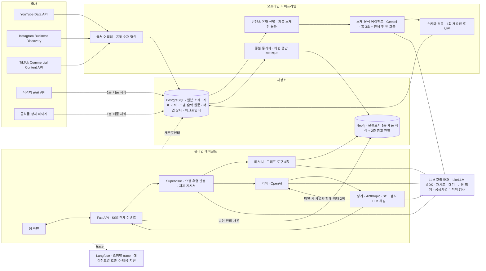
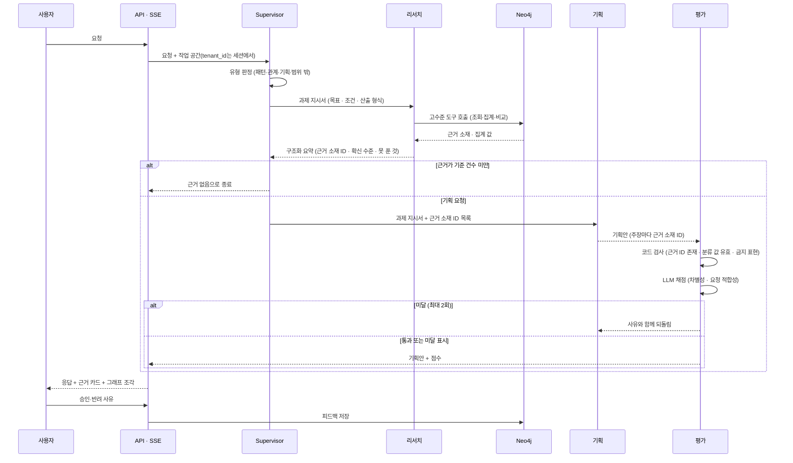
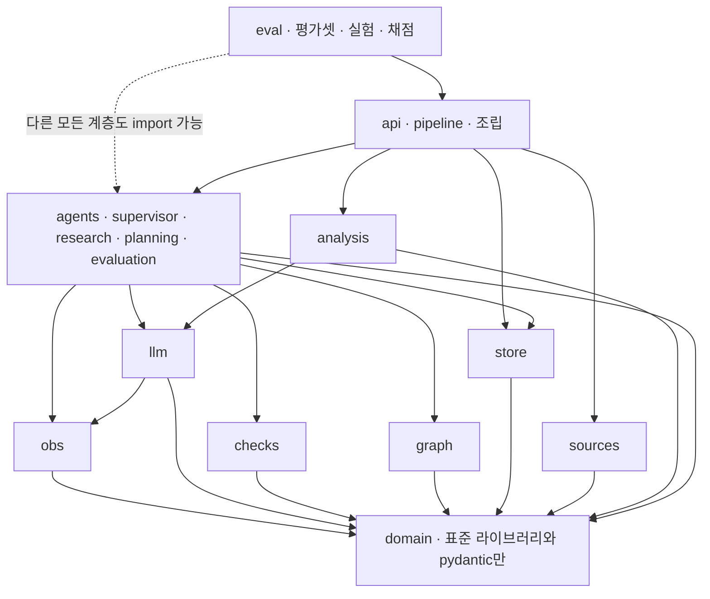

# 아키텍처

> 상태: 초안 (2026-11-12). 구현 전 설계이며 M0에서 확정한다.

## 구성도

아래 그림은 `docs/ARCHITECTURE.md`의 글과 `AGENTS.md` 계층 경계 표, `tests/test_architecture.py`의 `LAYER_IMPORTS`에 적힌 구성만 옮긴 것이다. 구현이 바뀌면 같이 고친다.

### 1. 전체 구성



### 2. 요청 한 번의 흐름 (온라인)



### 3. 계층 의존 방향 (코드 구조)



화살표는 "import할 수 있다"는 방향이다. 출처는 `AGENTS.md`의 계층 경계 표와 `tests/test_architecture.py`의 `LAYER_IMPORTS`이며 정확한 허용표는 테스트가 기준이다. `api`와 `pipeline`은 `domain`부터 `agents`까지 모든 계층을 직접 import할 수 있고(그림은 중복을 줄여 일부 화살표를 생략했다), 서로를 import하지 않는다. `eval`은 `api`·`pipeline`을 포함한 다른 모든 계층을 import할 수 있고 다른 계층은 `eval`을 import하지 않는다. `settings`(루트 모듈, `.env`를 읽는 유일한 함수)는 `obs`·`llm`·`sources`·`store`·`graph`·`api`·`pipeline`·`eval`이 import할 수 있어(`LAYER_IMPORTS` 기준) 그림에서 뺐다. 외부 SDK는 `litellm`은 `llm`, `neo4j`는 `graph`, `httpx`는 `sources`, `langfuse`는 `obs`, `fastapi`는 `api`, `psycopg`는 `store`와 `api`, `langgraph`는 `agents`와 `api`에서만 쓴다.

## 한눈에 보기

두 부분으로 나뉜다. **오프라인 파이프라인**은 소재를 모아 분석해 그래프에 넣고, **온라인 에이전트**는 그 그래프를 근거로 요청에 답한다. 둘은 그래프와 PostgreSQL로만 만난다.

```
[오프라인]  출처 어댑터 → 공통 소재 형식 → 콘텐츠 유형 선별 → 소재 분석 에이전트 → 스키마 검증 → 그래프 적재
            (YouTube, Instagram, TikTok)    (제품 소재만 통과)   (Gemini, 영상+캡션)

[온라인]    웹 화면 → API(SSE) → Supervisor → 리서치 → 기획 → 평가 → 응답 + 근거 + 그래프 조각
                                              (그래프 도구)       (코드 검사 + LLM 채점, 미달 시 기획으로 최대 2회)
```

## 디렉토리 구조
```
src/beautyads/   (패키지 이름 `beautyads`. 최상위 이름 충돌을 피해 한 단계 감쌌다)
  settings.py    `.env`를 읽는 유일한 함수
  domain/        소재·라벨·기획안·근거의 타입과 분류 값(닫힌 목록), 저장소·조회용 Protocol. 표준 라이브러리와 pydantic만
  obs/           trace(로컬 JSONL, Langfuse), 비용 원장 기록
  sources/       출처 어댑터(youtube, instagram, tiktok, mfds, mall). 공통 형식으로 변환
  store/         PostgreSQL 원본(소재, 지표 이력, 모델 출력 원문, 작업 상태, 테넌트 전용 데이터)
  analysis/      콘텐츠 유형 선별, 소재 분석 에이전트, 출력 스키마 검증
  graph/         온톨로지 스키마, 적재, 그래프 탐색 도구
  agents/        supervisor, research, planning, evaluation, 상태 정의
  checks/        결정론 검사(근거 존재, 금지 표현, 분류 값 유효성)
  llm/           모델 호출 래퍼(LiteLLM SDK), 재시도·대기·비용 집계·공급사별 누적액 검사
  api/           FastAPI, SSE 이벤트
  pipeline/      수집·분석·동기화 실행 진입점
  eval/          평가셋, 실험 실행기, 채점기
web/             Next.js 화면(대화, 근거 카드, 그래프). M3에서 추가
config/          sources.yaml(수집 대상), 모델·한도 설정
deploy/          docker compose(Postgres·Neo4j, 선택 profile `obs`=Langfuse), k3d 매니페스트
docs/            PRD, ADR, ARCHITECTURE, EVAL, TAXONOMY, results/
tests/
```

## 패턴

- **계층 의존 방향을 한쪽으로 고정한다.** `domain`은 표준 라이브러리와 pydantic만 쓴다. `llm`·`sources`·`store`·`graph`는 `domain`과 `settings`만(`llm`은 `obs`도), `checks`는 `domain`만(그래프 조회는 Protocol로 주입), `analysis`는 `domain`·`llm`, `agents`는 `graph`의 도구와 `checks`·`llm`·`store`·`obs`를 쓴다. `api`와 `pipeline`만 조립한다. 정확한 표와 외부 SDK별 허용 계층은 `AGENTS.md`의 계층 경계에 있고 테스트가 강제한다.
- **외부 호출은 래퍼 하나를 거친다.** 모델 호출은 `llm/`(LiteLLM SDK, proxy 없음, ADR-015), 출처 API 호출은 각 어댑터만 한다. 재시도·대기·비용 집계가 한곳에 모인다.
- **에이전트는 쿼리를 쓰지 않는다.** 리서치 에이전트에게 Cypher를 쓰게 하지 않고, "조건에 맞는 소재 찾기", "훅별 지표 집계", "카테고리 간 패턴 비교" 같은 고수준 도구를 준다. 도구 입력은 분류의 닫힌 값만 받는다.
- **판정할 수 있는 것은 코드가 판정한다.** 근거 소재 ID가 그래프에 있는지, 분류 값이 목록에 있는지, 금지 표현이 있는지는 `checks/`가 본다. LLM 채점은 차별성과 요청 적합성에만 쓴다.
- **만든 쪽과 평가하는 쪽을 나눈다.** 기획은 OpenAI, 평가는 Anthropic 모델이다.

## 데이터 흐름

### 오프라인: 수집과 분석
```
1. 어댑터가 config/sources.yaml의 계정에서 소재 목록과 지표를 가져온다
   - YouTube: 영상 ID, 제목, 설명, 길이, 조회수·좋아요·댓글
   - Instagram: 게시물 ID, 캡션, 유형, 조회수·좋아요·댓글, 영상 주소(있을 때만)
   - TikTok: 광고 ID, 게재 시작일·종료일, 도달 사용자 수 구간, 광고주 ID·이름, 영상 주소. 계정이 아니라 브랜드 검색어와 국가 목록으로 가져온다
2. 공통 소재 형식으로 변환하고 (출처, 원본 ID)로 중복을 제거해 PostgreSQL에 저장한다
3. 콘텐츠 유형을 판정한다. 제품 소재만 다음 단계로 간다
4. 소재 분석 에이전트가 두 번 호출한다
   - 첫 3초 구간: 훅 유형과 훅 묘사
   - 전체: 앵글, 포맷, 출연자, 구조, 소구점, 성분, 행동 유도, 카테고리
   - YouTube는 주소를 그대로 넘기고, Instagram과 TikTok은 파일을 받아 올린 뒤 분석이 끝나면 지운다
5. 출력을 스키마로 검증한다. 목록에 없는 값이면 1회 재요청하고, 다시 실패하면 보류로 남긴다
6. 검증을 통과한 라벨을 PostgreSQL에 저장한다. 모델 출력 원문도 그대로 둔다
7. 동기화 작업이 PostgreSQL에서 바뀐 행만 읽어 Neo4j에 반영한다(증분 동기화)
   - PostgreSQL이 원본이고 그래프는 거기서 만든 파생물이다. 그래프를 지우고 처음부터 다시 만들 수 있다
   - 반영은 같은 입력을 여러 번 넣어도 결과가 같게 만든다(MERGE). 중간에 실패해도 다시 돌리면 된다
   - 마지막으로 반영한 시점을 기록해 그 뒤에 바뀐 것만 가져온다
   - 지표처럼 자주 바뀌는 값은 원본에 이력으로 두고, 그래프에는 최신 값과 수집 시각만 올린다
   - "바뀐 행"은 PostgreSQL의 변경 시각으로 판정한다. 같은 값을 MERGE해도 Neo4j 카운터는 `properties_set`을 올리므로 카운터로 판정하지 않는다(`docs/CONTRACTS.md`의 Neo4j)
   - 실행은 스케줄러 없이 `make sync`(수동, 파이프라인 끝에서 호출)다. 로컬 실행이라 상시 스케줄 대상이 없다
```

### 온라인: 요청 처리
```
1. 웹 화면이 요청을 보내고 SSE로 단계 이벤트를 받는다
2. Supervisor가 요청 유형(패턴 질의, 관계 질의, 기획, 범위 밖)을 정한다
3. 리서치 에이전트가 그래프 도구로 패턴과 근거 소재를 찾는다
   - 근거가 기준 건수에 못 미치면 "근거 없음"으로 끝낸다(지어내지 않는다)
4. 기획 요청이면 기획 에이전트가 기획안을 만든다. 주장마다 근거 소재 ID를 단다
5. 평가 에이전트가 검사한다
   - 코드 검사: 근거 ID 존재, 분류 값 유효, 금지 표현
   - LLM 채점: 차별성, 요청 적합성
   - 미달이면 사유와 함께 기획으로 되돌린다(최대 2회). 그래도 미달이면 미달 표시를 달아 반환한다
6. 응답, 근거 카드, 응답에 쓰인 그래프 조각(노드·관계)을 함께 보낸다
7. 사용자의 승인·반려와 사유를 그래프에 저장한다
```

## 온톨로지

두 층으로 나눈다. **1층(제품 지식)**이 중심이고, **2층(광고 관찰)**은 1층에 연결된다. 수집 기록(채널, 광고주, 수집 시각, 원본 응답)은 그래프가 아니라 PostgreSQL 원본에 둔다. 그래프에는 질문에 답하는 데 필요한 관계만 올린다.

### 설계 방법: 역량 질문이 모델을 정한다

노드를 먼저 나열하지 않는다. 그래프가 답해야 할 질문(역량 질문, `docs/COMPETENCY_QUESTIONS.md`)을 먼저 정하고, 어떤 값을 노드로 만들지와 모델이 완성됐는지를 그 질문으로 판단한다. 완성 기준은 **모든 역량 질문이 1~4홉 탐색으로 답해지는가**다(홉은 노드 사이를 건너는 관계 수이고 속성 필터는 세지 않는다, ADR-012 후속 결정). 역량 질문 세트는 실험 E3의 관계형 질문 세트로 그대로 쓴다.

참고 사례(볼트 노트): 유진홈센터 온톨로지 PoC(현업 질문으로 모델 설계, 규칙의 노드화, 별칭 연결), 하나투어 상품 기획 에이전트(그래프에서 찾은 것만 쓰는 그라운딩).

### 1층: 제품 지식

| 노드 | 주요 속성 | 출처 |
|---|---|---|
| Brand | 이름 | `config/sources.yaml` |
| Product | 이름, 브랜드, 용량과 단위(ml·g·매), 판매 지역, **정가·판매가(원), ml(g·매)당 가격, 가격 수집 시각** | 브랜드 공식몰 상세페이지(ADR-013) |
| Category | `mask_pack`, `serum_ampoule`, `sun_care` | 고정 목록 |
| Form | 제형(시트, 세럼, 크림, 젤, 선스틱 등) | 제품 정보 |
| Ingredient | 표준명, 영문명, CAS 번호 | 식약처 화장품 원료성분정보 API(호출 실측 완료) |
| IngredientAlias | 별칭(예: 시카, 병풀, Centella) | 광고·제품 표기에서 수집, 표준명에 연결 |
| Efficacy | 효능(보습, 진정, 미백, 주름 개선, 자외선 차단 등). 분류의 소구점 값과 같은 목록 | 고정 목록 |
| SkinConcern | 피부 고민(건조, 트러블, 홍조, 모공, 칙칙함 등) | 고정 목록 |
| SkinType | 건성, 지성, 복합성, 민감성 | 고정 목록 |
| FunctionalCert | 기능성 인증 종류(미백, 주름 개선, 자외선 차단 등) | 식약처 기능성화장품 보고품목(`EE_NAME`, `SPF`·`PA`)·심사품목(`EE_DOC_DATA`, 활용신청 필요) API |
| ClaimRule | 표현 규칙. `rule_type`(`prohibited`·`requires_functional_cert`·`requires_substantiation`), 예외 문구, 출처 쪽 번호. 예: 기능성 인증 없는 제품에 미백·주름 개선 표현 금지 | 식약처 「화장품 표시·광고 관리 지침」 안내서-0086-07(`config/claim_rules.yaml`, ADR-014) |

| 관계 | 뜻 | 속성 |
|---|---|---|
| (Brand)-[:OWNS]->(Product) | 브랜드의 제품 | |
| (Product)-[:IN_CATEGORY]->(Category) | 카테고리 | |
| (Product)-[:HAS_FORM]->(Form) | 제형 | |
| (Product)-[:CONTAINS]->(Ingredient) | 전성분 | 표기 순서, 핵심 성분 여부, 출처 |
| (IngredientAlias)-[:ALIAS_OF]->(Ingredient) | 별칭 | |
| (Ingredient)-[:HAS_EFFICACY]->(Efficacy) | 성분의 효능 | 출처(필수) |
| (Efficacy)-[:ADDRESSES]->(SkinConcern) | 효능이 다루는 고민 | 출처 |
| (Product)-[:SUITS]->(SkinType) | 권장 피부 타입 | 출처(제품 표기) |
| (Product)-[:CERTIFIED_AS]->(FunctionalCert) | 기능성 인증 | 출처 |
| (ClaimRule)-[:APPLIES_TO]->(Efficacy, SkinConcern 또는 Category) | 규칙이 적용되는 범위. "여드름"·"홍조"처럼 피부 고민 쪽 표현에 걸리는 규칙이 많아 SkinConcern을 포함한다 | |

- 규칙은 개별 제품이 아니라 효능·카테고리에 붙인다. 새 제품은 연결만 생기면 규칙을 물려받는다(유진 사례의 규칙 상속).
- 성분과 효능의 연결은 출처가 없는 관계를 만들지 않는다. 출처를 못 찾은 연결은 비워 둔다. 출처는 식약처 기능성 고시 성분(미백·주름 개선·자외선 차단)과, 그 밖의 효능(진정·보습 등)은 출처를 붙인 소규모 수기 표로 한정한다(ADR-012 후속 결정). 그래서 이 연결에 기대는 질문의 답은 연결이 있는 범위에서만 나온다.
- 1층의 규모는 브랜드 14곳 × 카테고리 3개의 대표 제품으로 묶는다(수십 개). 전 제품을 다루지 않는다.
- 가격은 공식몰 기준 원화 가격이다. 가격 이력은 PostgreSQL에 두고 그래프에는 최신 값과 수집 시각만 올린다. 용량이 달라 그대로 비교하지 않고 단위당 가격으로 비교한다. 광고는 EU·글로벌 게재분이 섞여 있으므로 광고 시장의 가격과 비교하지 않는다. 할인가는 수시로 바뀌어 비교에는 정가를 쓴다.
- 성분 표기는 식약처 원료성분정보의 표준명으로 묶는다. 공공 API에 통용명(시카, 히알루론산)→표준명 연결이 없어 별칭 표는 직접 만든다(`docs/CONTRACTS.md`).

### 1층 구축 파이프라인 (초안)

```
대표 제품 목록(브랜드 × 카테고리) → 제품 정보 원본 확보(브랜드 공식몰 상세페이지, ADR-013) → 제품 단위 레코드 추출 → 성분명 표준화(식약처 표준명·별칭) → 스키마 검증 → PostgreSQL → 그래프 동기화 → 역량 질문으로 검증
```

- **제품 하나가 레코드 하나다.** 상세페이지를 조각내지 않는다. 조각을 나누면 성분 정보와 제품명이 다른 조각으로 떨어져 어느 제품의 성분인지 잃는다(리만코리아 사례의 No Chunking 결정과 같은 이유).
- 상세페이지가 긴 이미지면 일정 높이로 나누되 겹치게 나눠 경계에서 글자가 잘리지 않게 한다.
- 추출한 성분 표기는 식약처 원료성분정보의 표준명으로 묶고, 묶이지 않는 표기는 버리지 않고 `미해결`로 남겨 사람이 확인한다.
- 적재 뒤에는 역량 질문 몇 개를 실제로 돌려 답이 나오는지 확인한다(리만코리아 파이프라인의 마지막 "검색 가능 여부 검증" 단계와 같은 역할).

### 2층: 광고 관찰

| 노드 | 주요 속성 |
|---|---|
| Creative | 출처, 원본 ID, 링크, 게시 시각, 길이, 콘텐츠 유형, 언어, 지역, 게시 형태(일반 게시물·광고), 집행 주체(브랜드 직접·판매처·개인·불명), 지표 요약(최신 값과 수집 시각) |
| Hook, Angle, Format, Talent, CtaType | 분류의 닫힌 값 하나가 노드 하나 |
| Feedback | 승인·반려, 사유, 시각, `tenant_id` |

| 관계 | 뜻 | 속성 |
|---|---|---|
| (Creative)-[:PROMOTES]->(Product) | 소재가 다루는 제품(1층 연결) | 판정 근거(화면 표기·캡션), 확신 수준 |
| (Creative)-[:CLAIMS]->(Efficacy) | 소재가 주장한 효능(1층 연결) | (없음: v1 라벨은 효능 값만 저장하고 주장 문장은 저장하지 않는다) |
| (Creative)-[:MENTIONS]->(IngredientAlias) | 소재에 나온 성분 표기(1층 연결) | 표기 원문 |
| (Creative)-[:USES_HOOK]->(Hook) | 훅 유형 | 훅 묘사 원문 |
| (Creative)-[:HAS_ANGLE / HAS_FORMAT / FEATURES / HAS_CTA]->(...) | 분류 축 | |
| (Feedback)-[:ABOUT]->(Hook·Efficacy 등) | 피드백이 가리킨 패턴 | |

- 소재가 어느 제품을 다루는지 판정하지 못하면 `PROMOTES`를 만들지 않고 브랜드까지만 연결한다. 억지로 붙이지 않는다.
- **`PROMOTES` 판정 규칙(2026-11-15 승인)**: 소재의 제목·캡션을 정규화(NFKC·대소문자 무시·공백 제거)해 **같은 브랜드 제품의 이름 전체(또는 그 제품의 영문명·줄임말 별칭)**가 들어 있으면 잇는다. 후보가 여럿이면 가장 긴 이름을 고르고, 같은 길이의 후보가 둘 이상이면 만들지 않는다. 규칙은 dev 브랜드 결과로 다듬고 test 브랜드에서는 커버리지만 보고한다. 소재 분석 결과(v1 라벨)에는 제품 식별 필드가 없어 판정 근거는 제목·캡션 문자열뿐이다.
- **`PROMOTES` 한계**: (1) **TikTok 소재는 제목·캡션 필드가 비어 있어**(2026-11-15 읽기 전용 확인, 광고 도서관 응답에 텍스트가 없다) 이 규칙으로는 제품에 연결되지 않는다. TikTok은 CQ-09와 분포 용도로만 쓴다. (2) 토리든·넘버즈인은 공식몰에서 제품 정보를 받지 못해(ADR-013) 제품 노드가 없고 `PROMOTES` 커버리지에서 빠진다. (3) 제품 이름 전체가 소재 텍스트에 그대로 나오는 경우는 드물어(후보 24개 중 3개에서만 이름 전체가 나왔다, 2026-11-15 집계) 별칭 칸의 품질이 커버리지를 좌우한다.
- 채널·광고주·게재 기간·도달 구간 같은 수집 정보는 PostgreSQL에 두고, 그래프에는 질문에 필요한 요약만 Creative 속성으로 올린다.

### 두 층이 함께 답하는 질문(예)

- 진정을 주장한 세럼 광고 중, 실제로 진정 효능 근거가 있는 성분이 든 제품의 광고는 몇 건인가 (`Creative-CLAIMS→Efficacy`와 `Creative-PROMOTES→Product-CONTAINS→Ingredient-HAS_EFFICACY→Efficacy` 비교)
- 병풀 성분 제품의 광고는 진정과 트러블 중 무엇을 더 앞세우나
- 기획안이 주장한 효능이 그 제품의 인증·성분으로 뒷받침되는가, 그 효능에 걸린 표현 규칙이 있는가 (평가 단계의 코드 검사)

### 그라운딩 원칙

기획 에이전트는 **그래프에서 찾은 제품·성분·효능·소재만** 쓴다(하나투어 사례의 원칙). 주장하는 효능은 1층에서 근거 경로가 있어야 하고, 근거 경로는 기획안과 함께 화면에 보여 준다. 근거 경로가 없는 효능 주장은 평가의 코드 검사에서 실패한다.

### 지표 정규화

지표는 시점에 따라 변하므로 수집 시각과 함께 저장한다. 채널 규모가 크게 달라(팔로워 4만~194만) 조회수를 그대로 비교하지 않는다. 출처마다 지표의 뜻이 달라(조회수, 도달 구간) 출처 간 직접 비교도 하지 않는다. 정규화 방식은 `docs/EVAL.md`를 따른다.

## 상태 관리

| 저장소 | 담는 것 |
|---|---|
| PostgreSQL | 소재 원본 메타데이터, 지표 이력, 모델 출력 원문, 분석 작업 상태, LangGraph 체크포인터 |
| Neo4j | 온톨로지(검증을 통과한 라벨과 관계, 피드백) |
| Langfuse | 요청별 trace, 에이전트별 호출 수·비용·지연 |
| 파일 시스템 | 없음. 영상 파일은 분석 중에만 임시로 두고 지운다 |

테넌트 전용 데이터(브랜드 프로필, 기획안, 피드백, 대화 이력)는 두 저장소 모두에서 `tenant_id`로 구분한다.

- 온라인 요청의 대화 상태는 체크포인터에 둔다. 요청 하나가 thread 하나다.
- 분석 작업은 소재마다 상태(대기, 완료, 보류, 실패)를 가진다. 과부하로 실패한 건 다음 실행에서 다시 집는다.
- 단계 수·되돌림 횟수·요청당 비용 상한은 설정값이고, 넘으면 그 시점의 결과를 미완료 표시와 함께 반환한다.

## 도구 설계 규칙

리서치 에이전트가 쓰는 그래프 도구는 네 종류로 나눈다.

| 종류 | 하는 일 | 예 |
|---|---|---|
| 조회 | 조건에 맞는 소재·제품·브랜드를 찾는다 | 조건으로 소재 찾기, 소재 상세 보기 |
| 집계 | 분류 값별 건수와 지표 분포를 낸다 | 훅별 소재 수와 조회수 백분위 |
| 비교 | 두 범위의 패턴을 나란히 놓는다 | 카테고리 간 훅 분포 비교, 지역 간 포맷 비교 |
| 표시 | 화면에 그리라는 명령을 보낸다(모델에는 "그렸다"는 사실만 돌려준다) | 근거 카드 표시, 그래프 조각 표시 |

작성 규칙:
- 입력은 스키마로 정의하고 칸마다 설명을 단다. 분류 축에 해당하는 칸은 닫힌 값만 받는다.
- 도구 설명에 **언제 쓰는지와 언제 쓰지 않는지**를 적는다(예: "건수가 필요할 때만. 개별 소재 내용이 필요하면 조회 도구를 쓴다").
- 입력에 테넌트, 사용자, 오늘 날짜 칸을 두지 않는다. 서버가 실행 컨텍스트에서 넣는다.
- 실패는 예외로 끊지 않고 구조화된 실패(사유 코드, 다시 시도해도 되는지)로 돌려준다. 모델이 사유를 보고 다른 도구를 고르거나 근거 없음으로 끝낼 수 있게 한다.
- 도구 이름·종류·개수는 코드의 도구 등록 목록에서 뽑는다. 문서와 포트폴리오의 도구 수는 이 목록을 따른다.

## 스트리밍 이벤트와 화면 명령

API는 SSE로 네 종류의 이벤트를 보낸다.

| 이벤트 | 내용 |
|---|---|
| `token` | 답변 글자 |
| `step` | 에이전트 단계 시작·종료(Supervisor, 리서치, 기획, 평가, 되돌림) |
| `tool_start` | 도구 호출 시작(도구 이름, 종류) |
| `ui_command` | 화면에 그릴 것. 답변 글자와 별도 경로로 간다 |

화면 명령은 종류와 데이터로 이루어진다.

| 명령 | 화면 동작 |
|---|---|
| `show_evidence_cards` | 근거 소재 카드(썸네일, 링크, 지표, 라벨) |
| `show_graph_fragment` | 응답에 쓰인 노드와 관계를 그래프로 표시 |
| `show_distribution` | 분류 값별 분포 차트 |
| `show_plan` | 기획안 카드(훅, 장면 구성, 카피, 근거 ID, 평가 결과) |

화면 명령의 데이터는 모델을 거치지 않는다. 도구가 전체 결과를 화면 명령으로 보내고 모델에는 요약만 준다(컨텍스트 관리의 도구 반환 이원화).

## 요청 처리 공통 장치

모든 요청에 같은 순서로 적용한다.

| 장치 | 내용 |
|---|---|
| 기준일 고정 | 서버가 요청 시점의 기준일을 정해 프롬프트와 도구 컨텍스트에 넣는다. "최근 30일" 같은 상대 날짜는 서버가 날짜 범위로 풀어서 도구에 넘긴다. 모델이 오늘 날짜를 추측하지 않는다. 데이터의 마지막 수집 시각도 함께 알려 준다 |
| 동적 프롬프트 | 작업 공간의 브랜드 프로필(자사 제품, 말투, 금지 표현)과 과거 피드백 요약을 요청 시점에 프롬프트에 조립한다. 프롬프트 본문은 버전을 붙여 관리한다 |
| 프롬프트 캐시 | 에이전트마다 앞부분을 "도구 정의 → 고정 시스템 프롬프트" 순서로 고정해 캐시한다. 기준일, 작업 공간 정보, 브랜드 프로필, 피드백 요약처럼 요청마다 바뀌는 내용은 그 뒤에 둔다. 도구 목록은 정렬된 고정 순서로 보내고, 고정 부분에 시각이나 ID를 넣지 않는다. 캐시 적중량은 응답의 사용량 필드로 기록해 trace에 남긴다 |
| 한도 | 단계 수, 되돌림 횟수, 요청당 비용, 에이전트별 입력 토큰 |
| 이력 압축 | 컨텍스트 관리 절 참고 |
| 오류 처리 | 도구 실패는 구조화된 실패로, 모델 호출 실패는 대기 후 재시도로 처리한다. 끝까지 실패하면 그 시점의 결과를 미완료 표시와 함께 돌려준다 |

대화 상태(체크포인터)는 보존 기간을 설정값으로 두고, 지난 것은 정리 작업이 지운다.

## 멀티테넌트

테넌트는 **한 회사 안의 브랜드별 작업 공간**이다. 여러 브랜드를 가진 회사가 공통 기반(소재 분석, 온톨로지, 에이전트)을 함께 쓰고 브랜드마다 작업 공간을 나눠 쓴다는 전제다. 브랜드가 하나인 회사에서는 작업 공간 하나로 그대로 동작한다. 데모에는 작업 공간 2개를 둔다.

| 구분 | 데이터 | 범위 |
|---|---|---|
| 공용 | 공개 소재, 분류 라벨, 지표, 브랜드·제품·성분 노드 | 모든 테넌트가 읽는다. 쓰기는 파이프라인만 한다 |
| 테넌트 전용 | 브랜드 프로필(자사 제품, 말투, 금지 표현), 기획안, 승인·반려 피드백, 대화 이력, 압축 요약 | 그 테넌트만 읽고 쓴다 |

격리가 필요한 이유는 브랜드마다 말투, 금지 표현, 전략, 쌓인 피드백이 다르기 때문이다. 한 브랜드가 반려한 기획과 사유가 다른 브랜드의 기획안에 섞이면 그 브랜드에 맞지 않는 기획이 나온다. 같은 회사 안이라도 섞임은 모델의 판단이 아니라 코드로 막는다.

격리 규칙:
- **테넌트는 세션이 정한다.** 도구 입력에 테넌트 칸이 없다. 서버가 세션에서 꺼낸 `tenant_id`를 실행 컨텍스트에 넣고, 모든 도구가 호출 전에 그 값으로 범위를 건다. 모델이 다른 테넌트를 지정할 방법이 없다.
- **전용 데이터에는 전부 `tenant_id`가 붙는다.** 그래프의 전용 노드(Feedback, Plan, BrandProfile)와 PostgreSQL의 전용 테이블 모두. 그래프 도구는 공용 범위와 자기 테넌트 범위만 탐색한다.
- **체크포인터와 압축 요약도 테넌트 단위다.** thread 식별자에 테넌트를 포함하고, 요약을 다른 테넌트의 컨텍스트에 넣지 않는다.
- **trace에도 테넌트를 남긴다.** 테넌트별 비용·호출 수를 따로 본다.
- **관리 경로는 분리한다.** 전체 테넌트를 보는 관리 기능은 에이전트 도구로 노출하지 않는다.
- 검사가 실패하면 요청을 거부한다(fail-closed).

데모에서는 실제 인증 대신 테넌트 선택 화면을 둔다(데모용 장치이며 로컬에서만 연다). 실제 운영 실적이 아니라 **설계와 격리 검사**까지가 범위다.

## 컨텍스트 관리

에이전트가 넷이고 리서치 결과가 소재 수십 건이라, 아무 장치 없이 주고받으면 Supervisor의 입력이 원자료로 가득 찬다. 무엇을 누구에게 얼마나 넘길지를 설계로 고정한다.

| 장치 | 내용 |
|---|---|
| 과제 지시서 | Supervisor는 하위 에이전트에게 대화 전체를 넘기지 않는다. 목표, 조건(분류 값), 필요한 산출 형식만 담은 지시서를 만든다. 하위 에이전트의 컨텍스트는 서로 격리된다 |
| 구조화 핸드오프 | 하위 에이전트는 정해진 형식으로 돌려준다: 결론 요약, 근거 소재 ID 목록, 집계 값, 확신 수준, 못 푼 것. 형식은 스키마로 검증한다 |
| 원자료는 참조로 | 소재 상세·도구 원출력은 요청 상태 저장소에 두고 ID로만 가리킨다. 필요한 에이전트가 ID로 다시 꺼낸다 |
| 도구 반환 이원화 | 그래프 도구는 전체 결과를 화면(근거 카드, 그래프 조각)과 상태 저장소로 보내고, 모델에는 집계 요약과 상위 몇 건만 준다 |
| 대화 이력 압축 | 여러 턴이 쌓여 입력이 예산을 넘으면 오래된 턴을 요약으로 바꾸고 최근 턴은 그대로 둔다. 근거 소재 ID, 사용자가 준 조건, 승인·반려 피드백은 요약에서 빠지지 않도록 별도 칸에 고정한다 |
| 에이전트별 입력 예산 | 에이전트마다 입력 토큰 상한을 설정값으로 둔다. 넘으면 압축을 먼저 하고, 그래도 넘으면 근거 건수를 줄인다. 조용히 자르지 않고 줄였다는 사실을 trace에 남긴다 |
| 되돌림 시 전달 | 평가에서 기획으로 되돌릴 때는 이전 기획안 전문이 아니라 실패한 검사 항목과 사유만 넘긴다 |

핸드오프 요약에는 위험이 있다. 요약하다 근거가 빠지면 기획안이 근거 없이 쓰인다. 그래서 근거 ID는 요약 문장 안이 아니라 별도 목록 칸으로 넘기고, 평가의 코드 검사가 기획안의 근거 ID가 그 목록 안에 있는지 확인한다.

## 실행 환경

- 개발: Docker Compose로 Neo4j·PostgreSQL을 띄우고 앱은 로컬 프로세스로 돌린다.
- 시연·배포 구성 검증: k3d(로컬 k3s)에 같은 구성을 매니페스트로 올린다.
- 유료 서버에 상시 배포하지 않는다(ADR-007).
